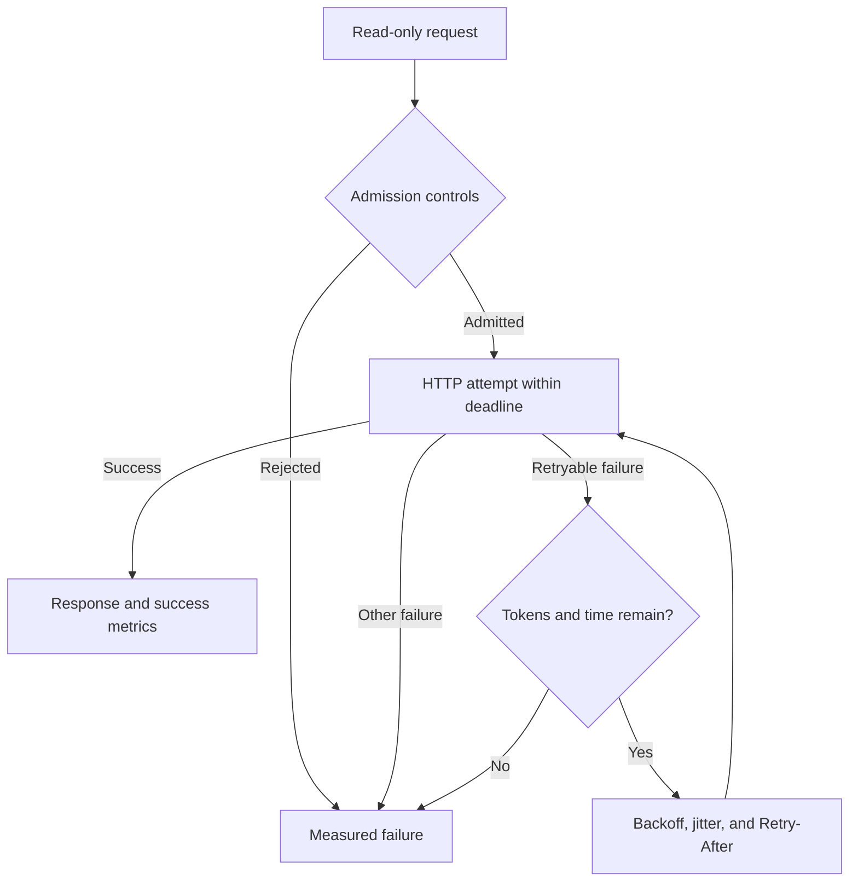

# SurgeGuard

**Bounded retries and overload protection for read-only HTTP dependencies.**

A working Python engineering project inspired by an Amazon reliability problem: during a dependency outage, retries can add work precisely when the dependency has the least capacity. SurgeGuard provides one retry layer with a shared retry budget, total deadlines, jitter, and early load shedding. It includes a real local HTTP fault lab, an optional recovery circuit breaker, automated tests, and measured reports.

This is an independent implementation using synthetic catalog traffic. It has no affiliation with Amazon and has not been deployed in an Amazon service.

## Documented company problem

Primary sources, checked on **12 October 2026**:

1. Amazon, [Timeouts, retries, and backoff with jitter](https://aws.amazon.com/builders-library/timeouts-retries-and-backoff-with-jitter/). The article describes how retries can worsen overload, recommends a single retry layer, and discusses jitter and local token buckets.
2. Amazon, [Using load shedding to avoid overload](https://aws.amazon.com/builders-library/using-load-shedding-to-avoid-overload/). The article explains rejecting excess work early and measuring useful completions rather than traffic alone.

Both current source pages display a publication date of 12 June 2026 and modification date of 15 June 2026; legacy Builders' Library URLs redirect to AWS Builder Center.

**Our engineering inference:** a dependency-specific client can place explicit bounds on amplification while exposing the cost in rejected or failed requests. The implementation and experiment below test that design; they do not establish Amazon production impact.

## Quick start

Requires **Python 3.12+**. No packages, API keys, cloud account, or network downloads are needed for the local tests and demo.

```bash
git clone https://github.com/psatyasaiganesh-oss/satya_repo.git
cd satya_repo/projects/2026-10-12-surgeguard
python -m unittest discover -s tests -v
python -m surgeguard demo --json reports/my-demo.json
```

On systems where the interpreter is named `python3`, substitute `python3` for `python`. On Windows, `py -3.12` also works when Python 3.12 is installed.

The demo creates ephemeral loopback HTTP servers, generates requests, checks eight invariants, prints JSON, and exits. It exercises actual TCP connections rather than a formula-only simulation.

## What is implemented

| Control | Behavior |
| --- | --- |
| Retry token bucket | Shared per client/dependency; original attempts do not consume credit; retries consume one token |
| Full jitter | Delay chosen uniformly from zero to a capped exponential backoff |
| Deadline | A total timeout covers all attempts, response reads, and backoff; each attempt also has its own timeout |
| HTTP classification | Retries 408, 429, 500, 502, 503, and 504 plus network/timeouts; other statuses return immediately |
| Retry-After | Supports seconds and HTTP dates; refuses a retry that would start beyond the remaining deadline |
| Bulkhead | Bounds active logical requests, including backoff; rejects excess work without network I/O |
| Optional breaker | Consecutive failures open the circuit; one half-open probe tests recovery; generations ignore stale completions |
| Cancellation | Releases bulkhead and recovery-probe slots and propagates cancellation to the caller |
| Safe defaults | GET/HEAD only; literal loopback IPs only; no redirects or credentials in URLs; bounded response size |
| Telemetry | Attempts, retries, completions, cancellations, rejection reasons, and separate successful/failed latency samples |

Budget bound for an interval of duration `T`:

```text
admitted retries <= initial bucket capacity + refill_rate * T
```

The default budget is 10 tokens with one token refilled per second. The outage experiment disables refill and uses 12 tokens to make its traffic bound directly reproducible. Circuit breaking is disabled by default; it is an optional design choice with recovery tradeoffs.

## Architecture



One event loop owns the client and its controls. The bulkhead covers the entire logical operation. Metrics retain at most 8,192 latency samples per outcome category and never label data with raw URLs.

## Measured results

The committed [raw report](reports/demo.json) was generated locally with Python 3.12.14 on Linux, 96 requests, concurrency 24, and seed 7.

| Scenario | Result | Interpretation |
| --- | --- | --- |
| Persistent outage, immediate four-attempt baseline | 384 backend calls; 0/96 requests succeed | A total outage cannot be fixed by retrying |
| Persistent outage, 12-token SurgeGuard budget | 108 backend calls; 0/96 requests succeed | 71.875% fewer failed backend calls; no availability improvement claimed |
| One transient failure per request; 96 retry tokens | 96/96 requests succeed in 192 backend calls | Recovery is possible when failures are transient and retry credit is provisioned |
| Simultaneous burst with limit 8 | 8 requests succeed; 88 are rejected; at most 8 backend handlers | Explicit load shedding keeps excess work away from the dependency |
| Optional breaker recovery | One of 16 simultaneous half-open callers probes; subsequent healthy call succeeds | Recovery probe concurrency remains bounded |

All eight demo invariants and **39 tests** passed. Timing and throughput values are recorded in the JSON report and will vary by host. The baseline/protected comparison changes both jitter and budget; it does not isolate jitter's performance effect. Separate scenarios use different workloads and configurations and should not be combined into a single availability claim.

## Interactive local demo

Terminal 1:

```bash
python -m surgeguard serve --port 8090 --mode transient
```

Terminal 2:

```bash
python -m surgeguard call --url http://127.0.0.1:8090/work --count 50 --concurrency 10 --retry-tokens 50
```

Other server modes: `healthy`, `outage`, and `slow`. For a burst, increase `--concurrency` above `--max-inflight`. Inspect the generated JSON for rejections as well as successes. Stop the server with Ctrl+C.

## Library use

```python
import asyncio
from surgeguard import Policy, ResilientClient, RetryBudget

async def main():
    # Start the local fault server in another terminal first.
    client = ResilientClient(
        Policy(max_attempts=3, total_timeout=.8, max_inflight=16),
        budget=RetryBudget(capacity=8, refill_rate=2),
    )
    result = await client.fetch("http://127.0.0.1:8090/work?id=example")
    print(result.to_dict())
    print(client.snapshot())

asyncio.run(main())
```

Use one long-lived client per dependency. Creating a new client per request resets its retry credit and defeats shared protection.

## Docker and CI

```bash
docker build -t surgeguard .
docker run --rm surgeguard
docker run --rm surgeguard call --help
```

The image runs as a non-root user. The repository includes a [GitHub Actions workflow](../../.github/workflows/surgeguard.yml) for Python 3.12 and 3.13, tests, compilation, and a fresh invariant-checked demo. Local evidence is in [validation.json](reports/validation.json). Docker execution and cloud CI results are reported separately from local Python checks.

## Design tradeoffs and limits

- Token buckets and bulkheads are per process, not fleet-wide quotas. Deploying many instances increases aggregate retry capacity.
- Load shedding deliberately sacrifices some requests. Tuning requires dependency latency, load, and service-level objectives; the demo settings are illustrative.
- Holding a bulkhead slot during backoff bounds memory/concurrency but may reduce goodput. A production scheduler could release the slot between attempts while separately bounding queued work.
- Deadlines rely on cooperative asyncio cancellation. A custom adapter that blocks the event loop or suppresses cancellation violates the timeout contract.
- The narrow HTTP transport opens a connection per attempt and supports simple HTTP/1.1 framing. It rejects chunked encoding, duplicate headers, and large bodies. It is a lab adapter rather than a replacement for a production HTTP library with pooling and full protocol support.
- Writes are intentionally outside the interface: safe retries of side-effecting operations require an application-specific idempotency contract.
- Retry credit reserved before a backoff is not refunded on cancellation. This is conservative and can temporarily lower available retries.
- The optional breaker observes completed logical requests and cannot stop calls already in flight. Its cooldown is configurable and may delay recovery.
- Metrics are in-process snapshots and bounded recent samples, not a persistent metrics service. Successful and failed latencies remain separate so fast rejection does not hide slow successes.
- No TLS integration, multi-process coordination, production load, or Docker execution is claimed by the local test report.

## Interview preparation

Read [the walkthrough](docs/INTERVIEW.md) for a one-minute explanation, design questions, honest resume bullets, and a five-minute demo. [The source guide](docs/CODE_MAP.md) explains where to begin if you are still learning Python.
