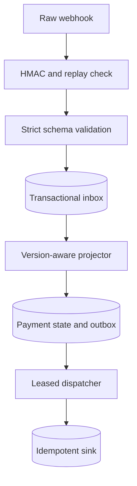

# LedgerGate

LedgerGate is a dependency-free Python reference service for processing payment webhooks without regressing state or repeating a business side effect. It combines a signed intake boundary, a transactional inbox, version-aware projection, and an idempotent transactional outbox in a locally reproducible SQLite lab.

This is an independent engineering exercise inspired by Stripe's public documentation. It is not a Stripe product, is not affiliated with Stripe, and does not claim production usage.

## The documented company problem

The following are facts documented by Stripe:

- Stripe says live-mode webhook deliveries are retried for up to three days with exponential backoff.
- Event ordering is not guaranteed. Stripe explicitly advises integrations not to depend on delivery order.
- Duplicate events can occur. Stripe recommends logging processed event IDs and, for some semantic duplicates, comparing the object ID and event type.
- Signature verification must use the unmodified raw request body. Stripe's signature scheme includes a timestamp, and its libraries use a five-minute default replay tolerance.
- Stripe recommends returning a successful response quickly and processing complex webhook work asynchronously.
- Stripe's API idempotency keys allow callers to retry an operation without creating a second operation.

Primary sources:

- [Stripe webhook documentation](https://docs.stripe.com/webhooks), especially the sections on automatic retries, event ordering, duplicate events, signatures, replay attacks, and asynchronous handling.
- [Stripe idempotent requests documentation](https://docs.stripe.com/api/idempotent_requests).

The following is this project's engineering inference, not a claim about Stripe's internal implementation: a payment consumer needs more than an `event_id` set. It needs an authenticated and durable intake, explicit stale/conflict handling, an atomic relationship between state changes and emitted work, and receiver-side idempotency for the failure window after a side effect succeeds but before its acknowledgement is saved.

## Why this matters to a business

Duplicate fulfillment can ship an order twice, issue repeated credits, or trigger duplicate downstream work. Out-of-order delivery can regress a completed payment to an earlier state. A crash between updating a database and publishing a message can lose work; a crash after the receiver accepts work but before the sender records the acknowledgement can repeat it. LedgerGate makes each failure mode observable and exercises it with synthetic data.

## Architecture



The HTTP handler performs only bounded parsing, authentication, validation, and inbox insertion before acknowledging. A worker separately projects state and dispatches side effects.

### Correctness contracts

| Boundary | Mechanism | Property demonstrated |
| --- | --- | --- |
| Sender to intake | Raw-body HMAC, timestamp window, secret rotation | Tampering and stale replay are rejected |
| Intake | `event_id` plus payload hash | Exact redelivery is harmless; conflicting reuse is quarantined |
| Logical transition | Unique effect key | A distinct event describing the same transition is deduplicated |
| Inbox to projection | One SQLite transaction | A crash cannot commit half a state transition |
| Reordered state | Monotonic synthetic resource version | Older arrivals cannot overwrite newer state |
| Projection to outbox | State update and outbox insert in one transaction | Committed business state does not lose its emitted work |
| Outbox to receiver | Lease token and receiver dedupe key | A retry after ambiguous acknowledgement repeats the attempt, not the effect |

The synthetic `version` is deliberate: Stripe does not promise this field on the simplified event shape used here. Stripe advises fetching the relevant objects when ordering matters. A real integration should use Stripe's official SDK and retrieve current object state rather than inventing a webhook sequence number.

## Security and validation

- The signature covers `timestamp + "." + raw_body` using HMAC-SHA256 and constant-time comparison.
- Up to eight active secrets and multiple `v1` signatures permit rotation without a verification shortcut.
- Signatures outside a configurable positive replay window are rejected, including future-dated signatures.
- Payloads are capped at 64 KiB and require `Content-Length`; transfer encoding is rejected by the reference server.
- JSON uses an exact allow-list schema and rejects duplicate fields, extra fields, booleans disguised as integers, invalid identifiers, and unsupported event types.
- The server binds only to a literal loopback address and returns `no-store`/`nosniff` headers.
- SQL values are parameterized. The two identifiers used by the internal snapshot query are fixed constants, not request input.

Production code should terminate TLS at a trusted proxy, use Stripe's official SDK for signature verification, protect secrets in a secret manager, authenticate operational endpoints, and use a production database/queue.

## Reproduce the experiment

Requirements: Python 3.11+; no packages, cloud account, Stripe account, or credentials are needed.

```bash
cd projects/2026-10-13-ledgergate
python -m unittest discover -s tests -v
python -m ledgergate demo --payments 400 --seed 13 --json reports/demo.json
```

The experiment creates 400 payments and shuffles created/final events together with exact duplicates, semantic duplicates, invalid signatures, and stale signed replays. It compares a deliberately naive authenticated consumer with LedgerGate, then injects crashes on both sides of the transactional-outbox boundary.

### Measured local result

Committed report: [`reports/demo.json`](reports/demo.json). These numbers came from one synthetic local run and are correctness evidence, not production throughput claims.

| Measurement | Naive consumer | LedgerGate |
| --- | ---: | ---: |
| Offered deliveries | 978 | 978 |
| Authenticated/accepted unique events | 938 authenticated deliveries | 800 accepted unique transitions |
| Exact duplicates detected | — | 76 |
| Semantic duplicates detected | — | 62 |
| Invalid or stale signatures rejected | 40 skipped | 40 rejected |
| Final payment-state mismatches | 167 / 400 | **0 / 400** |
| Successful fulfillment attempts/effects | 403 attempts | **300 unique effects** |
| Duplicate fulfillment attempts | 103 | **0 effects duplicated** |

All 8 top-level experiment invariants and all 6 injected-crash checks passed. The crash-after-sink scenario recorded two delivery attempts but one unique receiver effect, demonstrating why the receiver must enforce the idempotency key.

Timing in the JSON report describes this one machine and workload only. SQLite commits are intentionally configured for durability (`synchronous=FULL`), so the project optimizes for demonstrable correctness rather than benchmark speed.

## Run the HTTP demo

Terminal 1:

```bash
export WEBHOOK_SECRET='whsec_local_manual_secret_32_bytes'
python -m ledgergate serve --db /tmp/ledgergate.db --port 4242
```

Terminal 2:

```bash
export WEBHOOK_SECRET='whsec_local_manual_secret_32_bytes'
python -m scripts.send_sample http://127.0.0.1:4242/webhook
curl -s http://127.0.0.1:4242/metrics
```

The webhook response acknowledges durable intake; the metrics endpoint shows the asynchronous projection and outbox delivery.

## Docker

The image defaults to the credential-free demo:

```bash
docker build -t ledgergate .
docker run --rm ledgergate
```

## Design tradeoffs

- **SQLite over a hosted stack:** makes transactions, concurrency, failure injection, and recovery reproducible without paid infrastructure. It is not a horizontal queue.
- **Fast acknowledgement over inline completion:** lowers webhook timeout/retry risk, but callers must observe worker health and inbox age.
- **At-least-once dispatch over pretending to have exactly-once delivery:** the unavoidable ambiguous acknowledgement window is handled with a receiver idempotency key.
- **Strict small schema over broad Stripe compatibility:** makes the correctness contract auditable. It intentionally supports only three synthetic payment-intent event types.
- **Monotonic projection over arrival order:** prevents regressions, but a real Stripe adapter must obtain authoritative object state because Stripe does not guarantee the synthetic `version` used in this lab.
- **Conflict quarantine over last-write-wins:** inconsistent same-version state remains visible instead of being silently overwritten.

## Known limits

- This is a single-process, single-node reference implementation; SQLite write serialization limits scale.
- The included sink is a local table that models an idempotent downstream service. It does not perform real fulfillment.
- There is no dead-letter queue, retry backoff, multi-tenant isolation, operator authentication, TLS, or production metrics exporter.
- The worker currently stops if an unexpected internal exception escapes; production supervision and alerting are required.
- Payment reversals, refunds, disputes, partial capture, and multi-currency accounting are outside the deliberately small state machine.
- An older success may be dispatched before a later authoritative reversal arrives; real systems need compensating workflows.

## Repository map

```text
ledgergate/security.py   raw-body signature and replay verification
ledgergate/schema.py     strict event contract
ledgergate/store.py      transactional inbox, projection, outbox, and sink
ledgergate/service.py    intake boundary and batch drain
ledgergate/httpserver.py loopback HTTP endpoint and asynchronous worker
ledgergate/demo.py       deterministic comparison and crash injection
tests/                   security, schema, concurrency, HTTP, and recovery tests
docs/INTERVIEW.md        interview walkthrough and follow-up discussion
reports/                 captured validation evidence
```

## Resume bullets

- Built a dependency-free Python payment-webhook processor with raw-body HMAC/replay validation, SQLite transactional inbox/outbox, semantic deduplication, monotonic state projection, and leased idempotent dispatch; covered security, HTTP, concurrency, reordering, and crash recovery with 28 automated tests.
- Designed and ran a deterministic 978-delivery failure lab across 400 synthetic payments; reduced final-state mismatches from 167 to 0 and duplicate fulfillment effects from 103 to 0, with all 8 correctness invariants and 6 injected-crash checks passing (local synthetic results, not production traffic).

See [`docs/INTERVIEW.md`](docs/INTERVIEW.md) for a five-minute walkthrough and deeper questions.
