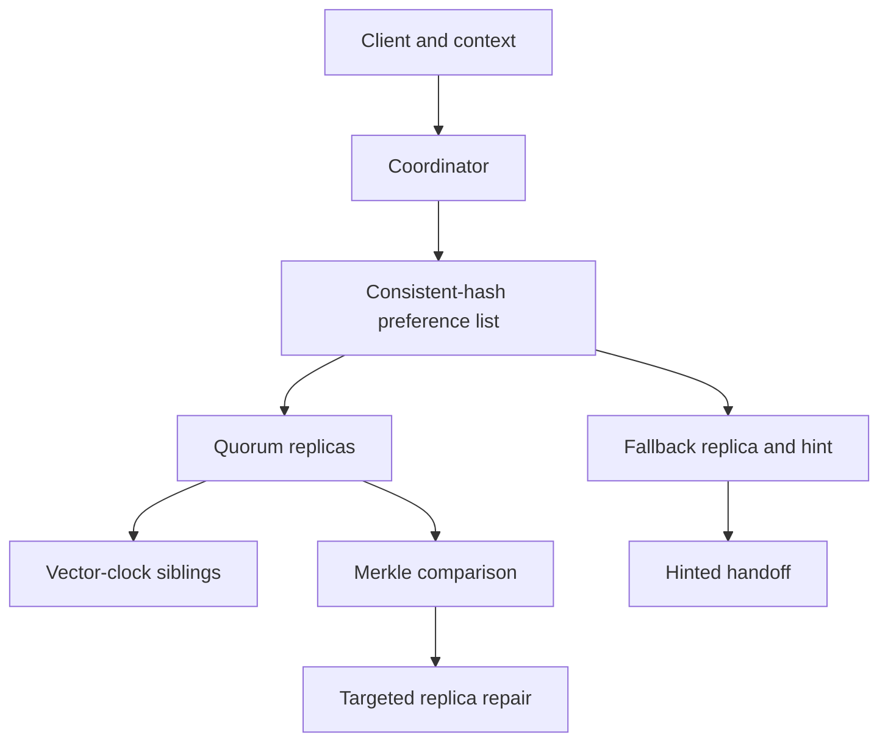

# QuorumForge

QuorumForge is a dependency-free Python laboratory for a failure-aware replicated key-value store. It implements consistent hashing with virtual nodes, configurable `N/R/W` quorums, vector-clock siblings, sloppy quorum, hinted handoff, read repair, tombstones, and fixed-bucket Merkle anti-entropy. A deterministic fault campaign measures availability, replica repair, conflict preservation, and partition balance.

This is an independent educational implementation inspired by Amazon's published Dynamo paper. It is not Amazon Dynamo or DynamoDB, is not affiliated with Amazon, and does not claim production use or production-equivalent performance.

## Documented company problem

The following are facts reported by Amazon's 2007 Dynamo paper:

- At Amazon's scale, server and network components fail continuously, and persistent-state handling affects reliability and scalability.
- Some services, including shopping-cart use cases, need reads and writes to remain available despite disk, network, or datacenter failures.
- Dynamo deliberately trades some consistency for availability, using object versioning and application-assisted conflict resolution.
- It partitions and replicates data with consistent hashing, uses configurable quorum-like reads and writes, and uses vector clocks to identify causal and concurrent versions.
- Its sloppy quorum selects healthy nodes beyond the normal replica set during failures; hinted handoff later returns those replicas.
- Merkle trees let replicas locate inconsistent ranges without transferring or scanning the entire dataset.

Primary sources:

- [Dynamo: Amazon's highly available key-value store — Amazon Science](https://www.amazon.science/publications/dynamo-amazons-highly-available-key-value-store)
- [Dynamo paper PDF — Amazon Science CDN](https://cdn.amazon.science/ac/1d/eb50c4064c538c8ac440ce6a1d91/dynamo-amazons-highly-available-key-value-store.pdf)

The following is this project's inference: a compact fault-injection lab that makes these tradeoffs observable is a useful way to demonstrate distributed-systems reasoning for SDE, backend, cloud, and SRE interviews. QuorumForge borrows published ideas but its code, API, metrics, fixed-bucket Merkle layout, and experiments are original to this project. It does not assert that Amazon uses this implementation.

## Business impact

An unavailable cart or session store blocks customer actions; silently lost concurrent writes can remove a user's update; unrepaired replica loss narrows the safety margin before a later failure becomes data loss. QuorumForge demonstrates the engineering tension: accepting a write on substitute replicas raises availability, but creates repair work and may expose concurrent versions that the application must reconcile.

## Architecture



### Implemented contracts

| Concern | Implementation | Observable property |
| --- | --- | --- |
| Partitioning | SHA-256 ring with configurable virtual nodes | Deterministic placement and smoother key distribution |
| Replication | Distinct physical-node preference list | `N` intended owners for every key |
| Availability | Configurable `R` and `W`; healthy-node fallback | Writes can succeed when intended owners are unavailable |
| Temporary failure | Hint stored with intended owner | Recovery moves the version back and drains the hint |
| Causality | Immutable vector clocks | Ancestors are removed; concurrent branches remain siblings |
| Resolution | Client returns merged context with new value | One descendant supersedes all observed siblings |
| Read repair | Coordinator compares quorum responses | Reachable stale owners receive missing versions |
| Permanent divergence | 64-bucket Merkle index | Equal branches are skipped; only divergent buckets are inspected |
| Deletion | Causally versioned tombstone | Older values cannot immediately resurrect a deletion |

The default lab uses `N=3`, `R=2`, and `W=2`. QuorumForge also permits weaker configurations for conflict experiments, because exposing the availability/consistency tradeoff is part of the exercise.

## Security and input handling

- Keys are allow-listed and capped at 128 UTF-8 bytes; values are capped at 8 KiB.
- Vector contexts have validated node identifiers, positive 63-bit counters, at most 64 entries, and may reference only nodes in the cluster.
- The HTTP boundary rejects duplicate JSON fields, unexpected fields, unsupported transfer encoding, invalid content types, oversized bodies, and missing/ambiguous coordinator parameters.
- The reference server binds only to literal loopback addresses, serializes cluster mutations with a lock, suppresses request logs, and emits `no-store` and `nosniff` headers.
- SHA-256 is used for deterministic placement and integrity comparison, not for password storage or secrecy.

The HTTP API is a local lab, not a public service. A production deployment would require TLS, authentication and authorization, signed or server-managed opaque contexts, rate limits, persistence, tenant isolation, and audit logging.

## Reproduce the fault campaign

Requirements: Python 3.11+; no dependencies, credentials, cloud account, or external services.

```bash
cd projects/2026-10-14-quorumforge
python -m unittest discover -s tests -v
python -m quorumforge demo --keys 600 --seed 14 --json reports/demo.json
```

The experiment performs five independent checks:

1. Fails two of seven nodes and compares strict intended-replica quorum with sloppy quorum.
2. Recovers the nodes and delivers every stored hint to its intended owner.
3. Deletes 12 replica copies and uses a Merkle comparison to target repair.
4. Creates two concurrent cart updates across a network partition, returns both siblings, then resolves them with their merged context.
5. Compares one token per node with 64 virtual nodes over 6,000 deterministic keys.

## Measured local results

Complete evidence: [`reports/demo.json`](reports/demo.json), [`reports/tests.log`](reports/tests.log), and [`reports/validation.json`](reports/validation.json). These are synthetic in-process results on one machine, not Amazon traffic or a production benchmark.

| Experiment | Baseline | QuorumForge result |
| --- | ---: | ---: |
| Writes offered with two failed nodes | 600 | 600 |
| Strict intended-quorum writes rejected | 76 | — |
| Sloppy-quorum writes accepted | — | **600 / 600** |
| Hinted replicas created and delivered | — | **453 / 453** |
| Under-replicated keys after recovery | — | **0** |
| Injected missing replica copies | — | 12 |
| Merkle repair | Full scan: 157 shared keys | **12 repaired; 42 keys examined** |
| Concurrent cart branches before/after resolution | Last-write-wins loses one update | **2 siblings → 1 resolved value; 0 updates lost** |
| Primary-placement coefficient of variation | 0.718619 with one token | **0.109226 with 64 virtual nodes** |

All 11 experiment invariants passed. The timing in the report is informational only: the simulator uses in-process calls and does not model real disks, networks, queues, or tail latency.

## Run the HTTP API

Terminal 1:

```bash
python -m quorumforge serve --nodes 5 --port 4343
```

Terminal 2:

```bash
python -m scripts.client_demo http://127.0.0.1:4343
curl -s http://127.0.0.1:4343/cluster
```

Example causal update:

```bash
curl -s -X PUT 'http://127.0.0.1:4343/kv/cart:7?coordinator=n1' \
  -H 'Content-Type: application/json' \
  -d '{"value":"{\"items\":[\"book\"]}"}'
```

Read the returned context, then include it in the next `PUT`. A write without context represents an independent branch and can legitimately create a sibling.

## Docker

```bash
docker build -t quorumforge .
docker run --rm quorumforge
```

The image runs as an unprivileged user and defaults to the credential-free fault campaign.

## Design tradeoffs

- **Sloppy quorum over strict membership:** improves write availability but temporarily places data outside its intended owners and requires durable repair.
- **Vector clocks over timestamps:** preserves causality without trusting synchronized clocks, but metadata and application conflict handling are more complex.
- **Application reconciliation over silent last-write-wins:** avoids hiding concurrent updates, but pushes domain decisions to the caller.
- **Fixed Merkle buckets over a topology-coupled tree:** keeps this lab small and stable across tests, at the cost of examining every key sharing a divergent bucket.
- **In-memory deterministic nodes over processes and sockets:** makes faults exactly reproducible without infrastructure, but cannot measure production latency or durability.
- **Explicit membership over simulated gossip:** keeps placement auditable; node join, removal, and decentralized membership convergence remain future work.

## Known limits

- All nodes run in one process and store data in memory; process exit loses state.
- Failures are deterministic flags and link partitions, not OS processes, packet loss, latency, disk faults, or datacenter infrastructure.
- Merkle repair is pairwise for key ranges jointly owned by two replicas; it is not a background multi-node scheduler.
- Hints are not persisted and have no expiry, capacity limit, or backpressure policy.
- Membership is fixed. There is no gossip, bootstrap streaming, rebalancing, rack awareness, or datacenter placement.
- There is no tombstone garbage-collection protocol, so a production implementation would need a carefully coordinated retention rule.
- A failed quorum can leave partial writes, as real distributed failures can; callers need idempotent retries and reconciliation.
- Context is validated but not cryptographically opaque. Only the loopback API is supported.
- This is Dynamo-inspired, not a compatible implementation of DynamoDB and not an evaluation of Amazon's current services.

## Code map

```text
quorumforge/clock.py       vector clocks and causal relations
quorumforge/ring.py        consistent hashing and virtual nodes
quorumforge/node.py        sibling storage and hints
quorumforge/merkle.py      targeted hash-tree comparison
quorumforge/cluster.py     quorum coordination, handoff, read repair
quorumforge/httpserver.py  bounded loopback JSON API
quorumforge/demo.py        deterministic fault and baseline experiments
tests/                     algorithm, cluster, HTTP, and recovery tests
docs/INTERVIEW.md          interview narrative and follow-up questions
```

## Resume bullets

- Built a dependency-free Python distributed key-value lab with consistent hashing, virtual nodes, configurable `N/R/W` quorums, vector-clock conflict detection, sloppy quorum, hinted handoff, read repair, tombstones, and Merkle anti-entropy; validated with 35 automated tests.
- Designed a deterministic 600-write failure campaign where sloppy quorum accepted 600/600 writes versus 76 strict-quorum rejections, delivered 453/453 hints after recovery, and repaired 12 injected replica losses while examining 42 of 157 shared keys (synthetic local results).

See [`docs/INTERVIEW.md`](docs/INTERVIEW.md) for the five-minute explanation, expected questions, and honest project framing.
