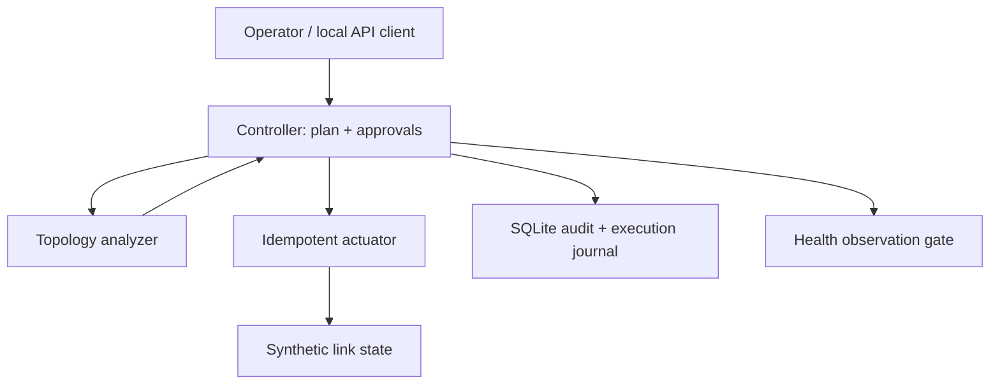

# RouteProof

A fail-closed network change-safety service for a synthetic backbone. RouteProof validates an immutable change plan against service and recovery invariants, binds independent approvals to the exact analysis, applies each step idempotently, waits for health evidence, and supports crash-safe rollback.

This is an **independent engineering exercise inspired by a documented Meta incident**. It is not Meta software, has not been used by Meta, and does not model Meta's private topology or tooling.

## Sourced problem

### Documented facts

Meta Engineering reported that on October 4, 2021:

- a routine maintenance command intended to assess global backbone capacity unintentionally took down all backbone connections;
- a bug in a command-audit tool prevented it from stopping the command;
- the loss of backbone connectivity made DNS sites withdraw BGP advertisements, so otherwise-operational DNS servers became unreachable;
- normal network access and internal recovery tools were also unavailable, requiring onsite recovery;
- services were restored carefully to avoid a second failure from the returning traffic surge.

Primary source: Meta Engineering, ["More details about the October 4 outage"](https://engineering.fb.com/2021/10/05/networking-traffic/outage-details/), October 5, 2021. See [docs/SOURCES.md](docs/SOURCES.md).

### Our inference and scope

The incident shows why a change gate must reason about downstream dependencies and the operator's recovery path, not only whether a command is syntactically valid. RouteProof therefore treats backbone reachability, DNS advertisement capacity, independent management access, and tolerance of one additional failure as explicit invariants. The two-person approval policy, exact topology model, SQLite stores, API, synthetic health evidence, and rollback protocol are our design choices—not claims about Meta's implementation.

The business risk is inferred: a globally unsafe infrastructure change can make customer-facing services undiscoverable while also making diagnosis and recovery slower. This project does not estimate Meta's financial impact.

## What it implements

- Strict, closed JSON schemas with duplicate-key, size, type, identifier, and reference validation.
- A graph analyzer that simulates every step and every remaining failure domain.
- Explicit backbone, DNS, management-path, and baseline-health invariants.
- Fail-closed handling for stale topology, analyzer exceptions, no-op operations, and incomplete evidence.
- Immutable plan hashes and two distinct reviewer approvals bound to the analysis hash.
- Separate controller and actuator SQLite databases in WAL mode.
- Optimistic topology versions and deterministic operation IDs.
- Recovery from a crash after device acknowledgement but before controller journaling.
- A health-observation gate after each applied step.
- Resumable reverse-order rollback and an append-only audit trail.
- SHA-256 token hashes at rest, role separation, token revocation, and a loopback-only bounded HTTP API.
- Automated tests, a synthetic incident demo, a local microbenchmark, Docker, and multi-version CI.

## Architecture



The synchronous API validates and records intent. Analysis is deterministic and side-effect free. Execution is a durable state machine. The actuator has its own receipt store so replaying a step after a controller crash returns the original acknowledgement instead of changing state twice.

## Safety state machine

1. **DRAFT** — immutable plan recorded.
2. **ANALYZED / BLOCKED** — all steps and one additional failure are simulated; errors block.
3. **APPROVED** — two distinct reviewers approved the exact analysis hash.
4. **AWAITING_OBSERVATION** — one idempotent step was applied; no next step can run yet.
5. **EXECUTING / SUCCEEDED / PAUSED** — healthy evidence advances; unhealthy evidence pauses.
6. **ROLLING_BACK / ROLLED_BACK** — applied steps are reversed with durable progress.

Any out-of-band topology version change before a step moves the plan to **STALE**. RouteProof never silently reuses approvals after re-analysis.

## Local setup

Requirements: Python 3.11+; no third-party packages, cloud account, or API key.

```bash
cd projects/2026-10-21-routeproof
python -m unittest discover -s tests -v
python -m routeproof demo
python scripts/validate.py
```

The demo uses temporary files, randomly generated local tokens, actual loopback HTTP calls, an injected process boundary, and a synthetic topology. It prints JSON and does not contact external services.

### Manual API bootstrap

```bash
python -m routeproof init \
  --topology examples/topology.json \
  --actuator /tmp/routeproof-actuator.db

export ROUTEPROOF_TOKEN='replace-with-at-least-32-random-characters'
python -m routeproof operator \
  --control /tmp/routeproof-control.db \
  --actuator /tmp/routeproof-actuator.db \
  --id alice --role requester

python -m routeproof serve \
  --control /tmp/routeproof-control.db \
  --actuator /tmp/routeproof-actuator.db --port 8080
```

Register separate reviewer and executor identities with different tokens. Send the example plans to `POST /v1/plans`, then call `/analyze`, `/approve`, `/execute`, and `/observe`. The reference server deliberately accepts only `127.0.0.1`; it has no TLS termination.

## Reproducible scenarios

The demo proves these behaviors with synthetic data:

- a complete data-center disconnection is blocked before execution;
- a DNS reachability cascade is blocked;
- an injected validator timeout produces a blocked result;
- one approval cannot execute a plan, while two bound approvals can;
- a crash after the actuator commits is recovered through the same operation receipt;
- unhealthy canary evidence pauses execution;
- reverse-order rollback restores the changed link;
- an out-of-band topology change invalidates execution;
- public health, unauthorized, and authenticated HTTP paths return distinct results;
- 500 real in-process analyses produce measured local throughput and latency.

Run the command to obtain measurements for the current machine. CI runs the same demo; these numbers are engineering-lab measurements, not production network performance.

## Security and validation choices

- Tokens are never accepted in URLs or printed by the service; only their hashes are stored.
- API request bodies are limited to 64 KiB and use closed schemas.
- Transfer-encoded, ambiguously framed, duplicate-key, and identity-overriding requests are rejected.
- Request logs are disabled so authorization headers cannot leak through access logs.
- Roles separate request, review, and execution.
- Plans, analyses, and approvals are content-addressed.
- The demo HTTP client disables environment proxies so a local bearer token is not forwarded elsewhere.
- Database files are created with owner-only permissions on POSIX systems.

## Design tradeoffs

| Choice | Benefit | Cost |
| --- | --- | --- |
| Exact graph simulation | Explainable, deterministic decisions | Abstracts away real routing policy and convergence |
| Fail closed | Unknown safety never becomes permission | Validator outages stop maintenance |
| Two durable SQLite stores | Demonstrates the real crash boundary | No distributed consensus or high availability |
| Health gate per step | Limits blast radius | Slower rollout and requires trustworthy probes |
| Version-bound execution | Detects out-of-band drift | Operators must re-plan after any unrelated change |
| Loopback-only standard-library API | Credential-free local demo | Not an internet-facing control plane |

The backend has durable state and multi-step work. A serverless deployment would need an external transactional database plus a durable workflow/queue; the included SQLite processes must not be copied unchanged into stateless functions.

## Known limits

- The actuator changes a synthetic link database, not routers, BGP sessions, DNS servers, or cloud resources.
- Reachability and failure-domain simulation do not model capacity, routing policy, convergence time, or correlated failures beyond declared domains.
- Health evidence is supplied by a trusted local executor; there is no monitoring integration or attestation.
- One controller database and one actuator database run on a single machine.
- Rollback is safety checked by topology-version fencing but is not re-analyzed as a new plan.
- Local bearer tokens, loopback binding, and file permissions are not a replacement for mTLS, a secret manager, hardware-backed identities, or an enterprise authorization system.
- This lab provides no availability, performance, or business-savings claim.

## Interview walkthrough

Use [docs/INTERVIEW.md](docs/INTERVIEW.md) for a concise demonstration and tradeoff discussion.
