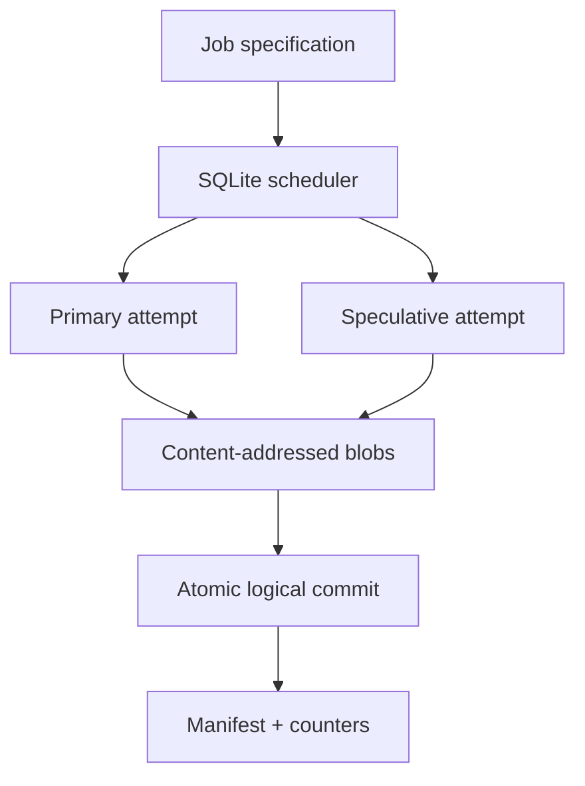

# SpecuFlow

SpecuFlow is a durable local task scheduler that shortens the tail of a parallel job by launching a bounded backup attempt for a slow shard. It combines speculative execution with leases, capability-bound attempts, content-addressed results, atomic first-winner commit, duplicate suppression, nondeterminism detection, exactly-once logical counters, and restart recovery.

This is an **independent engineering exercise inspired by a documented Google challenge**. It is not Google software, has not run at Google, and does not reproduce Google's private infrastructure.

## Sourced problem

### Documented facts

Jeffrey Dean and Sanjay Ghemawat's 2004 Google MapReduce paper describes a runtime that partitions work, schedules tasks, handles worker failures, and coordinates distributed output. It calls unusually slow final tasks **stragglers** and lists degraded disks, resource contention, and faulty machine initialization as causes. Near the end of a job, Google's implementation scheduled backup executions and accepted whichever attempt completed first. The paper says this normally added only a few percent of computational resources and reports that its sort workload took 44% longer when backup tasks were disabled.

The paper also explains that deterministic operations can retain sequential-equivalent semantics by publishing private temporary output atomically, ignoring later completion messages, and preventing duplicate attempts from inflating counters.

Primary sources:

- Google Research: [MapReduce: Simplified Data Processing on Large Clusters](https://research.google/pubs/mapreduce-simplified-data-processing-on-large-clusters/), OSDI 2004.
- [Original paper PDF](https://research.google.com/archive/mapreduce-osdi04.pdf), especially sections 3.3, 3.6, and 4.9.

See [docs/SOURCES.md](docs/SOURCES.md) for the fact/inference boundary.

### Our inference

A slow shard can delay a batch pipeline even when almost all capacity is idle, affecting freshness and downstream deadlines. Blind duplication, however, can double side effects or accept inconsistent output. Therefore, a useful small-scale implementation should optimize tail completion while proving which attempt owns the logical result.

The business impact above is an inference. We do not claim Google cost, latency, adoption, or production results.

## What this implementation provides

- Strict, closed JSON job schemas with duplicate-key, identifier, depth, size, type, and finite-number checks.
- Durable jobs, tasks, attempts, leases, counters, and audit events in SQLite WAL mode.
- Atomic claims under concurrent workers and bounded retries after lease expiry.
- Fixed-threshold speculative backup attempts on a different worker.
- Random per-attempt capability tokens stored only as SHA-256 hashes.
- Content-addressed result blobs published through temporary-file `fsync` and atomic rename.
- First-valid-result commit with deterministic operation identity.
- Equal loser output suppression and **job failure on different loser output**.
- Counter aggregation from committed tasks only, avoiding double counting.
- Durable restart recovery and integrity verification of every committed blob.
- A real local worker pool, fault scenarios, microbenchmark, Docker image, and Python 3.11–3.13 CI.

## Architecture



The scheduler prefers untouched and retryable shards before spending capacity on duplicates. Once a running attempt crosses the configured threshold, one idle worker may receive a speculative copy. Both workers compute independently. A valid content-addressed blob is written before the metadata transaction; then exactly one attempt becomes the winner. A late equal result is recorded as suppressed. A late different result marks the entire job failed because the supposedly deterministic task is unsafe.

## Correctness contracts

1. A job ID is immutable; an exact retry is idempotent, while a different specification conflicts.
2. A worker can modify only the attempt for which it holds the unlogged capability token.
3. A lease must be active for the first result commit. Expired work is retried with a new attempt.
4. At most the policy's bounded number of speculative attempts can run.
5. Only one output digest and one counter set contribute to each logical shard.
6. A duplicate with the same digest is harmless; a different digest is an integrity failure.
7. Reading or verifying a result recomputes its SHA-256 digest.

## Local setup

Requirements: Python 3.11+. The core has no third-party dependencies or external credentials.

```bash
cd projects/2026-10-22-specuflow
python -m unittest discover -s tests -v
python -m specuflow demo
python scripts/validate.py
```

Run the example as a persistent local job:

```bash
python -m specuflow run \
  --database /tmp/specuflow.db \
  --blobs /tmp/specuflow-blobs \
  --job examples/job.json \
  --workers 4

python -m specuflow status \
  --database /tmp/specuflow.db \
  --blobs /tmp/specuflow-blobs \
  --job-id example-word-count
```

## Demo scenarios

`python -m specuflow demo` performs actual local work and reports:

1. The same 16-shard job with and without speculation, including one injected 320 ms primary straggler.
2. Output equality and counter equality between both runs.
3. A scheduler restart while an abandoned attempt's lease is active, followed by bounded retry after expiry.
4. A primary/backup commit race in which the backup wins and the equal primary result is suppressed.
5. A conflicting loser output that fails the job as nondeterministic.
6. SHA-256 verification of every committed result.
7. A 200-task, eight-worker, zero-delay scheduling/storage benchmark.

Recorded measurements are in [reports/validation.json](reports/validation.json) and [reports/demo.json](reports/demo.json). They describe one local synthetic run, not production performance.

### Recorded local validation

- 58 automated tests passed on Python 3.12.14 with SQLite 3.53.1.
- The 16-shard controlled workload completed in 0.325259 seconds without speculation and 0.121229 seconds with one backup attempt: a measured 62.73% reduction for that synthetic run.
- All baseline and speculative outputs matched, counters were counted once, and 16 committed blobs passed checksum verification.
- The zero-delay scheduling/storage workload committed 200 tasks with eight threads in 0.619634 seconds end to end, or 322.77 tasks/second.
- Docker was unavailable locally; the repository workflow builds and validates the non-root container in GitHub Actions.

## Security and validation

- No task payload is interpreted as a command, imported module, file path, or URL.
- Job and result bodies are bounded to 1 MiB; each payload is bounded to 16 KiB.
- Output must identify the exact claimed shard.
- Tokens are returned once, hashed at rest, redacted from status/audit APIs, and compared in constant time.
- Blob digest paths accept lowercase SHA-256 only, preventing traversal.
- Database and blob directories use owner-only POSIX permissions.
- Retries and duplicates are bounded by policy; there is no unlimited retry loop.

See [SECURITY.md](SECURITY.md).

## Design tradeoffs

| Decision | Benefit | Cost |
| --- | --- | --- |
| Fixed speculation threshold | Deterministic and explainable | Less efficient than per-stage latency quantiles |
| First valid digest wins | Low-latency atomic commit | Requires deterministic task logic |
| Compare late loser output | Detects hidden nondeterminism | Keeps loser work alive long enough to validate it |
| SQLite + filesystem blobs | Credential-free durable local demo | Single-host availability and throughput |
| Capability token per attempt | Narrow worker authority | No enterprise identity or remote transport |
| Content-addressed immutable blobs | Idempotent publication and integrity checks | Local garbage collection is not implemented |

## Known limits

- This is not a full MapReduce engine: it does not implement shuffle, reducers, data locality, distributed RPC, autoscaling, or multi-host consensus.
- Worker threads share one machine and use synthetic delay injection; they do not emulate Google's cluster.
- The coordinator trusts the host clock and filesystem atomic rename.
- The threshold is configured, not learned from production latency distributions.
- The system does not cancel Python threads; it drains loser attempts so output consistency can be checked.
- There is no blob garbage collector, TLS endpoint, external identity provider, or highly available database.
- Side effects outside the returned result blob are forbidden rather than transactionally coordinated.

## Interview walkthrough

Use [docs/INTERVIEW.md](docs/INTERVIEW.md) to demonstrate the latency/correctness tradeoff, then explain how a production design would add distributed storage, heartbeat telemetry, adaptive thresholds, cancellation, and workload isolation.
