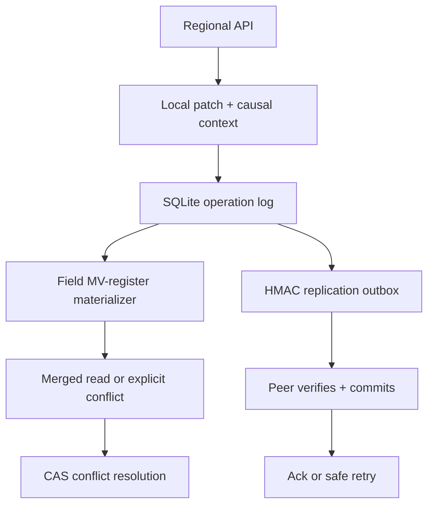

# MergeMesh

Conflict-visible, authenticated multi-region document replication in Python and SQLite.

MergeMesh is an independent engineering exercise inspired by Microsoft Azure Cosmos DB's documented multi-region write-conflict problem. It is a working local backend—not a portfolio page, a Cosmos DB emulator, or Microsoft software.

## The sourced problem

Microsoft documents that applications writing the same item concurrently in multiple Azure Cosmos DB regions can produce insert, replace, and delete conflicts. Its default last-write-wins (LWW) policy uses a numeric conflict-resolution path and converges every region to one complete winning item. Microsoft also provides custom application resolution and a conflict feed. [Microsoft Learn: conflict resolution policies](https://learn.microsoft.com/en-us/azure/cosmos-db/conflict-resolution-policies)

Microsoft's reliability guidance says multi-write regions can improve resilience and geographic write latency, but replicate asynchronously, cannot use strong consistency in that configuration, and can produce conflicting changes. [Microsoft Learn: Cosmos DB reliability](https://learn.microsoft.com/en-us/azure/reliability/reliability-cosmos-db#multiple-write-regions)

Microsoft Research describes replicated data types—including multi-value registers—as specialized protocols for eventually consistent replicas. [Microsoft Research: Replicated Data Types](https://www.microsoft.com/en-us/research/publication/replicated-data-types-specification-verification-optimality/)

**Our inference:** when an application replaces a multi-field object as one LWW item, two disconnected writers changing different fields can converge by discarding one complete revision. That is an application-level consequence illustrated here, not a claim about a Microsoft incident. For product catalogs, incident metadata, or user settings, a silent lost edit can create incorrect pricing, stale availability, or operational rework.

[Exact fact/inference boundary](docs/SOURCES.md)

## What this project implements

- Per-field causal multi-value registers: independent fields merge; concurrent writes to one field remain explicit.
- First-class tombstones: concurrent delete/update races cannot silently resurrect or erase data.
- Explicit compare-and-set resolution: a resolver must name the exact candidate operation IDs it observed.
- Durable SQLite operation log, materialized field versions, vector clocks, delivery acknowledgements, and hash-chained audit events.
- Commit-before-ack at-least-once replication with stable operation IDs and canonical-payload deduplication.
- Per-origin HMAC-SHA-256 replication envelopes with constant-time signature checks.
- Tenant-bound bearer-token HTTP API with bounded, duplicate-key-safe, closed-schema JSON.
- Restart recovery, integrity verification, a synthetic three-region demo, benchmark, Docker, and Python 3.11–3.13 CI.

## Architecture



Each immutable operation contains a unique `(origin, sequence)` dot and the document clock the writer observed. For each mutated field:

| Causal relation | Action |
| --- | --- |
| Incoming version is newer | Remove dominated candidates and store incoming candidate |
| Incoming version is older | Record the operation but ignore its stale field mutation |
| Versions are concurrent | Retain both candidates and expose a conflict |
| Patch does not mention field | Leave that field unchanged |

This separates **physical delivery** (at least once and possibly reordered) from **logical state application** (idempotent by operation ID). Resolution is another causally newer operation, so it replicates through the same path.

## Invariants

1. One `op_id` and origin sequence can identify only one canonical payload; collisions fail closed.
2. An envelope key may sign only operations whose `origin` matches its key ID.
3. Receiver commit happens before sender acknowledgement. Lost acknowledgements cause safe replay, not lost state.
4. A dominated field version cannot replace a causally newer one, even when messages arrive backward.
5. Concurrent same-field versions are never silently chosen by the merge engine.
6. A resolution succeeds only if the current candidate IDs exactly equal the resolver's precondition.
7. Tenant identity comes from the API token, never from a caller-controlled body field.

## Run locally

Requires Python 3.11+; the core project has no third-party runtime dependencies.

```bash
cd projects/2026-10-23-mergemesh
python -m mergemesh demo
```

The demo creates temporary east, west, and central replicas and exercises:

- a whole-document LWW baseline that loses one disjoint edit;
- field-aware merging that preserves both disjoint edits;
- a visible same-field conflict and explicit resolution;
- a delete/update conflict and tombstone resolution;
- receiver commit followed by a lost acknowledgement and deduplicated retry;
- tampered-envelope rejection, restart recovery, convergence, and integrity checks;
- a 120-document synthetic benchmark.

Run all tests and reproduce the JSON validation report:

```bash
python -m unittest discover -s tests -v
python scripts/validate.py
```

Inspect a persisted demo directory:

```bash
python -m mergemesh demo --workdir /tmp/mergemesh-demo
python -m mergemesh status \
  --database /tmp/mergemesh-demo/east.db \
  --region east --tenant acme --document keyboard-1
python -m mergemesh verify \
  --database /tmp/mergemesh-demo/east.db --region east
```

## HTTP API

The API is deliberately bound to loopback by default. Provide the token through the environment rather than a command-line argument:

```bash
export MERGEMESH_API_TOKEN='replace-with-at-least-32-random-bytes'
python -m mergemesh serve \
  --database /tmp/mergemesh-api.db --region east --tenant acme --port 8080
```

```bash
curl -sS -X POST http://127.0.0.1:8080/v1/documents/keyboard-1 \
  -H "Authorization: Bearer $MERGEMESH_API_TOKEN" \
  -H 'Content-Type: application/json' \
  --data '{"changes":{"price":90,"availability":"IN_STOCK"}}'

curl -sS http://127.0.0.1:8080/v1/documents/keyboard-1 \
  -H "Authorization: Bearer $MERGEMESH_API_TOKEN"
```

Endpoints:

| Method | Path | Purpose |
| --- | --- | --- |
| `GET` | `/healthz` | Public liveness and region identity |
| `GET` | `/v1/documents/{id}` | Tenant-scoped merged state, conflicts, clock, and ETag |
| `POST` | `/v1/documents/{id}` | Patch `changes` and/or `delete_fields`; optional `expected_etag` |
| `GET` | `/v1/conflicts` | Tenant-scoped unresolved conflict inventory |
| `POST` | `/v1/documents/{id}/resolve` | Resolve the exact `expected_candidates` set to a value or tombstone |

See [SECURITY.md](SECURITY.md) before adapting the server.

## Container

```bash
docker build -t mergemesh .
docker run --rm --network none --read-only \
  --tmpfs /tmp:rw,noexec,nosuid,size=128m \
  --cap-drop ALL --security-opt no-new-privileges \
  mergemesh
```

The image runs as UID 10001. CI compiles and tests Python 3.11, 3.12, and 3.13, then runs tests and the demo in the restricted container.

## Reproduced local results

The committed [validation report](reports/validation.json) is generated by `python scripts/validate.py`; [demo output](reports/demo.json) is a separate run.

| Check | Result |
| --- | --- |
| Automated tests | 107 passed |
| Disconnected disjoint edits | `price=90` and `availability=BACKORDER` both preserved |
| Concurrent same-field edit | Two candidates surfaced; explicit value `87` converged |
| Concurrent delete/update | Two candidates surfaced; explicit tombstone converged |
| Lost acknowledgement | Retry deduplicated; one logical field version |
| Tampered envelope | Rejected before state application |
| Restart and audit verification | Passed on all three replicas |
| Synthetic benchmark | See committed report for measured time and rate |

All timings are local, single-process, synthetic observations. They are not Azure measurements, production capacity, availability claims, or cost estimates.

## Design tradeoffs

- **Field granularity over whole-document LWW:** preserves independent edits but cannot infer business meaning for genuine same-field conflicts.
- **Vector clocks over wall time:** captures causality without trusting synchronized clocks, but metadata grows with region membership.
- **Visible conflicts over arbitrary automatic merge:** avoids silent loss, but some workloads need an operator or domain-specific resolver.
- **Commit before ack:** prevents acknowledged-but-lost writes, while requiring durable IDs and idempotency for replay.
- **Tombstones over physical delete:** blocks late resurrection, but safe garbage collection needs a global progress protocol not included here.
- **SQLite over external infrastructure:** makes every scenario reproducible without cloud accounts, while serializing writes within each replica.

## Known limits

- The sync driver is an in-process lab, not a network daemon or managed replication service.
- Pre-shared HMAC keys have no rotation/KMS workflow and give each verifier the ability to forge that origin.
- There is no TLS, rate limiting, multi-document transaction, dynamic membership, batch apply, backpressure, schema registry, or tombstone compaction.
- Generic field semantics are not suitable for invariants such as unique usernames, bank balances, or bounded inventory; those require coordination or specialized data types.
- The convergence properties are heavily tested under reorder and duplication but not mechanically proven.
- SQLite and one host do not model cross-region latency, correlated failure, disk loss, or cloud-scale contention.

## Project map

```text
mergemesh/model.py   strict schemas, operations, vector-clock rules
mergemesh/store.py   SQLite replica, materializer, resolution, audit verification
mergemesh/sync.py    HMAC envelopes, retry-safe delivery, anti-entropy driver
mergemesh/api.py     tenant-bound standard-library HTTP API
mergemesh/demo.py    fault scenarios and synthetic benchmark
tests/               107 unit, integration, concurrency, security, and HTTP tests
```

For an interview narrative and likely questions, use [docs/INTERVIEW.md](docs/INTERVIEW.md).
