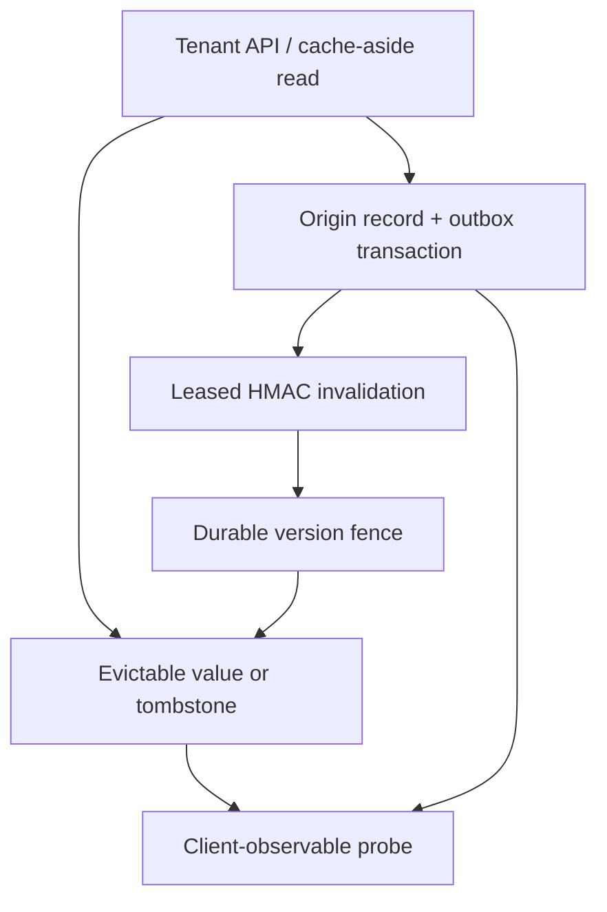

# CacheFence

Race-safe cache invalidation, retry-safe delivery, and client-observable consistency checks in Python and SQLite.

CacheFence is an independent engineering exercise inspired by a cache-consistency problem documented by Meta. It is a working local backend—not a portfolio page, a TAO/Polaris reimplementation, Meta software, or a claim of production use.

## The sourced problem

Meta's June 8, 2022 engineering article [Cache made consistent](https://engineering.fb.com/2022/06/08/core-infra/cache-made-consistent/) documents this interleaving:

1. A cache begins filling `x=42` from the database.
2. The database changes to `x=43`.
3. The invalidation carrying `x=43` reaches the cache.
4. The older fill completes last and writes `x=42`, potentially leaving an indefinitely stale value.

The article says versions can reject older data, but eviction can delete the cache's knowledge of the newer version before an old fill arrives. It also describes dynamic caches as being mutated by both read fills and write invalidations, making race windows numerous. Meta reports that some inconsistencies can look like data loss to users, describes Polaris checking client-observable invariants at multiple timescales, and gives a real example where different content existed at the same version because an error path removed only lower versions.

Meta's earlier [Wormhole pub/sub article](https://engineering.fb.com/2013/06/13/core-infra/wormhole-pub-sub-system-moving-data-through-space-and-time/) documents the operational need to propagate refills and invalidations to caches within and across data centers.

**Our inference:** a smaller system can demonstrate the same classes of failure and useful defenses by separating durable ordering metadata from evictable values, committing invalidations before acknowledging them, and measuring only inconsistencies a cache-aside client could observe. Those are design choices in this project, not claims about Meta's internal implementation.

[Detailed fact/inference boundary](docs/SOURCES.md)

## What this project implements

- Durable per-key version fences that survive value eviction and process restart.
- Stale-fill rejection plus a bounded refetch when an invalidation wins the race.
- SHA-256 content identity so different content at one version fails closed and is quarantined.
- Source write and durable outbox append in one SQLite transaction.
- Leased, at-least-once delivery with unguessable acknowledgement capabilities and a dead-letter budget.
- Stable event IDs, canonical-payload deduplication, and commit-before-ack retry behavior.
- HMAC-SHA-256 envelopes with constant-time verification and origin/key binding.
- Positive and negative caching, TTL eviction, and per-key singleflight for cold-read stampedes.
- Persistent consistency samples that retry transient lag before alerting and resolve when clients become safe.
- Tenant-bound, loopback-only HTTP API with CAS writes, bounded strict JSON, closed schemas, and bearer auth.
- Hash-chained audit events, restart verification, fault scenarios, a local benchmark, Docker, and Python 3.11–3.13 CI.

## Architecture



The ordering rule is compact:

| Incoming operation | Fence comparison | Result |
| --- | --- | --- |
| Cache fill | version below fence | Reject as stale; caller refetches once |
| Cache fill | same version, different digest/tombstone bit | Quarantine and fail closed |
| Cache fill | at or above compatible fence | Install value and advance fence if needed |
| Invalidation | lower version | Deduplicate/record but never move fence backward |
| Invalidation | same version, different payload | Quarantine and fail closed |
| Invalidation | newer version | Advance fence and evict any entry no newer than it |
| Replayed invalidation | exact event and payload | Return duplicate; safe to acknowledge |

## Safety invariants

1. A source mutation and its invalidation event either both commit or neither commits.
2. Value or TTL eviction never deletes the latest durable version fence.
3. A lower-version fill cannot replace state after the cache observes a newer invalidation.
4. Equal version numbers imply equal content digest and deletion state; disagreement is corruption, not a tie.
5. The receiver commits or deduplicates before the sender acknowledges delivery.
6. A lease can be acknowledged only with its random capability and only before expiry.
7. A signing key may authenticate only events from its matching origin.
8. Tenant identity comes from server configuration and the bearer token, never from a request body.
9. A cache miss is client-safe in cache-aside mode because the next read consults the origin.

## Run locally

Python 3.11+ is required. The core project has no third-party runtime dependencies.

```bash
cd projects/2026-10-24-cachefence
python -m cachefence demo
```

The demo creates temporary SQLite stores and exercises:

- the documented naive stale-fill ordering;
- rejection and one-time refetch of the same race;
- a durable fence surviving value eviction;
- a lost acknowledgement followed by exact-event deduplication;
- quarantine of different content at the same version;
- 32 concurrent cold reads coalesced to one origin read;
- retry, alert, and resolution states for an observable inconsistency;
- an 80-key, 2,000-warm-read local SQLite microbenchmark.

Run all checks:

```bash
python -m unittest discover -s tests -v
python scripts/validate.py
```

Persist a demo and verify both audit chains:

```bash
python -m cachefence demo --workdir /tmp/cachefence-demo
python -m cachefence verify \
  --origin-db /tmp/cachefence-demo/guarded-race/origin.db \
  --cache-db /tmp/cachefence-demo/guarded-race/cache.db
```

## HTTP API

The standard-library API deliberately binds only to loopback. Supply secrets through the environment rather than command-line arguments:

```bash
export CACHEFENCE_API_TOKEN='replace-with-at-least-32-random-bytes'
export CACHEFENCE_SIGNING_KEY='use-a-distinct-at-least-32-byte-key'
python -m cachefence serve --state-dir /tmp/cachefence-api --tenant acme --port 8080
```

```bash
curl -sS -X PUT http://127.0.0.1:8080/v1/items/profile \
  -H "Authorization: Bearer $CACHEFENCE_API_TOKEN" \
  -H 'Content-Type: application/json' \
  --data '{"value":{"plan":"pro"},"expected_version":0}'

curl -sS http://127.0.0.1:8080/v1/items/profile \
  -H "Authorization: Bearer $CACHEFENCE_API_TOKEN"

curl -sS -X DELETE http://127.0.0.1:8080/v1/items/profile \
  -H "Authorization: Bearer $CACHEFENCE_API_TOKEN" \
  -H 'Content-Type: application/json' \
  --data '{"expected_version":1}'
```

| Method | Path | Purpose |
| --- | --- | --- |
| `GET` | `/healthz` | Public liveness and cache identity |
| `GET` | `/v1/items/{key}` | Tenant-bound cache-aside read with source indicator and ETag |
| `PUT` | `/v1/items/{key}` | CAS source write followed by invalidation delivery |
| `DELETE` | `/v1/items/{key}` | CAS tombstone write followed by invalidation delivery |

Read [SECURITY.md](SECURITY.md) before adapting this lab server.

## Container and CI

```bash
docker build -t cachefence .
docker run --rm --network none --read-only \
  --tmpfs /tmp:rw,noexec,nosuid,size=128m \
  --cap-drop ALL --security-opt no-new-privileges \
  --pids-limit 128 cachefence
```

The image runs as numeric UID 10001. GitHub Actions compiles and tests Python 3.11, 3.12, and 3.13, then repeats the test suite and demo in the restricted container.

## Reproduced local results

The committed [validation report](reports/validation.json) and [demo output](reports/demo.json) are direct outputs from this project.

| Check | Observed result |
| --- | --- |
| Automated tests | 82 passed |
| Naive documented ordering | Origin version 2, cache version 1 (stale reproduced) |
| Guarded ordering | One stale fill rejected; returned version 2/value 43 |
| Fence after eviction | Version 2 retained; late version 1 fill rejected |
| Lost acknowledgement | First receiver commit accepted; retry deduplicated; outbox delivered |
| Equal-version contradiction | Rejected and one incident quarantined |
| Concurrent cold reads | 32 callers, one origin read |
| Probe | `retry` at first sample, `alert` after threshold, then `resolved` |
| Warm-read benchmark | See report for this machine's p50, p95, elapsed time, and rate |

All timings are local, single-process, synthetic observations. They are not Meta measurements, production capacity, availability, cost, or cloud-scale claims.

## Design tradeoffs

- **Durable fence separate from value:** closes the eviction hole, at the cost of metadata that needs a safe garbage-collection policy.
- **Version plus digest:** catches equal-version contradictions, but assumes the origin is the version authority for each key.
- **Commit before acknowledgement:** prevents acknowledged-but-unapplied invalidations, while making replay and idempotency mandatory.
- **Per-key singleflight:** protects the origin during a cold burst in one process, but does not coordinate separate service instances.
- **Delayed probe alarm:** filters short-lived lag, but alert latency is at least the configured reporting threshold.
- **SQLite:** gives reproducible transactions and crash persistence with no paid service, but serializes write contention on one host.
- **Symmetric HMAC:** is dependency-free and detects tampering, but verifiers holding the key could forge an origin event.

## Known limits

- This is a one-origin/one-cache-host lab, not a globally distributed cache or Meta service emulator.
- Fence compaction is intentionally omitted; safe deletion requires proving no older fill or event can still arrive.
- The source version counter is per key, not a globally ordered log offset.
- Missing never-created keys are not negative-cached because they have no authoritative version; explicit tombstones are.
- The in-process delivery driver has no broker, TLS, KMS-backed rotation, cross-host backpressure, or automated replay of dead letters.
- The probe directly reads the local origin on every sample; a production design should delay and rate-limit expensive source-bypass checks.
- The loopback HTTP adapter has no TLS, rate limiting, multi-tenant token registry, or reverse-proxy trust model.
- Audit hashes detect later mutation when verified; they are not externally anchored signatures.
- The tests exercise process restart, reorder, replay, corruption, and concurrency but are not a formal proof.

## Project map

```text
cachefence/model.py     strict schemas, digests, snapshots, invalidation identity
cachefence/origin.py    source records, transactional outbox, leases, audit verification
cachefence/cache.py     durable fences, values/tombstones, quarantine, integrity checks
cachefence/pipeline.py  HMAC envelopes and commit-before-ack delivery
cachefence/service.py   cache-aside reads, stale refetch, per-key singleflight
cachefence/probe.py     persistent multi-timescale observable consistency samples
cachefence/api.py       tenant-bound standard-library HTTP adapter
cachefence/demo.py      race scenarios and synthetic benchmark
tests/                  82 unit, integration, concurrency, integrity, and HTTP tests
```

For a concise interview narrative and follow-up questions, see [docs/INTERVIEW.md](docs/INTERVIEW.md).
