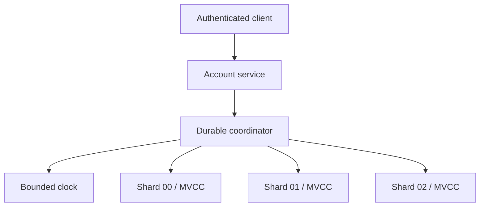

# ChronoCommit

ChronoCommit is a working Python/SQLite laboratory for recoverable, cross-shard transactions whose commit order respects a bounded clock-uncertainty interval. It combines immutable MVCC versions, optimistic validation, durable two-phase commit, commit wait, idempotent request replay, authenticated participant decisions, exact historical snapshots, and crash recovery.

It is an **independent educational implementation inspired by a documented Google Spanner challenge**. It is not Google code, a Spanner clone, or evidence of production use.

## Sourced problem

Google's 2012 [Spanner paper](https://research.google/pubs/spanner-googles-globally-distributed-database-2/) describes a globally distributed, synchronously replicated, multi-version database that supports externally consistent distributed transactions. Its time API exposes clock uncertainty; the paper identifies that API as important to external consistency, lock-free read-only transactions, and past reads.

Current Google Cloud documentation makes the application-facing problem concrete:

- A transaction's operations are atomic: either all succeed or all fail. [Transactions overview](https://docs.cloud.google.com/spanner/docs/transactions)
- External consistency means transactions appear serial, and that serial order agrees with observable real-time commit order. [TrueTime and external consistency](https://docs.cloud.google.com/spanner/docs/true-time-external-consistency)
- MVCC stores immutable timestamped versions so snapshot reads can avoid blocking writes. Correct timestamp assignment prevents a later debit from appearing before an earlier completed deposit.
- Serializable transaction conflicts can require aborts and retries; read-only transactions can use a consistent historical timestamp without taking write-blocking locks.

### Documented facts versus this project's inference

| Category | Statement |
| --- | --- |
| Documented by Google | Spanner uses TrueTime-derived timestamps, MVCC, distributed transactions, external consistency, and snapshot reads. |
| Documented by Google | If transaction T1 finishes before T2 starts committing, T2 receives a later timestamp; readers cannot observe T2 without T1. |
| Project inference | A small bank-transfer service is a clear local test bed for partial commits, ambiguous retries, stale writers, historical reads, and commit ordering. |
| Independent design | ChronoCommit uses one local coordinator, three separate SQLite participant files, HMAC-bound decisions, and a caller-configured clock bound. These are lab choices, not descriptions of Google's implementation. |

## Why this matters to a business

A cross-partition payment, inventory reservation, or entitlement update can fail after only some participants have acted. Retrying an ambiguous response can repeat the business effect; assigning timestamps from drifting local clocks can make a later operation appear earlier; and a stale writer can overwrite a newer decision. Those failures create incorrect balances, oversold stock, access mistakes, reconciliation work, and poor auditability.

ChronoCommit demonstrates the controls behind a safer boundary:

- no partial visibility after a durable commit decision;
- no duplicate debit when a successful request is retried;
- no stale overwrite after a conflicting transaction wins;
- no acknowledgement until the configured uncertainty interval is past the commit timestamp;
- repeatable historical reads over immutable versions;
- deterministic recovery after crashes at prepare, decision, participant commit, and pre-acknowledgement boundaries.

## Architecture



Each shard is a separate SQLite WAL database. Stable hashing places a tenant/key pair on a participant. The coordinator database stores the idempotency mapping, immutable request digest, participants, commit timestamp, decision, acknowledgement, and hash-chained audit history.

### Commit protocol

1. Validate bounded input and bind the idempotency key to the logical request.
2. Read the clock interval and choose `commit_ts >= interval.latest`, greater than every previously assigned timestamp.
3. Ask each participant to validate expected MVCC versions and persist write intents.
4. Durably record the commit decision only after every participant prepares.
5. Idempotently materialize immutable versions on every participant.
6. Wait until `clock.earliest > commit_ts`; only then record and return acknowledgement.

Recovery aborts `PREPARING` transactions because no commit decision exists. It must finish `COMMITTING` transactions because the decision is durable. An already committed participant accepts the same authenticated decision without creating another version.

## Correctness and security properties

- **Atomicity:** a transaction becomes committed only after every listed participant has prepared; recovery completes a durable commit decision.
- **Isolation:** every mutation carries an expected version. A stale or concurrent writer is rejected during prepare.
- **Durability:** coordinator decisions, participant intents, versions, and audit records use SQLite `FULL` synchronous WAL storage.
- **External-order model:** timestamps are monotonic and ACK waits for uncertainty to pass. A persisted latest-clock observation rejects backward movement after restart.
- **Idempotency:** a logical request replays the original transaction and historical post-commit view; changing the business request under the same key fails closed.
- **Integrity:** values carry SHA-256 digests; decision HMACs bind phase, shard, transaction, timestamp, and payload; coordinator and shard audit chains are independently verified.
- **Tenant boundary:** tenant identity comes from server configuration rather than request JSON.
- **HTTP hardening:** loopback-only binding, constant-time bearer comparison, strict JSON, body limits, closed identifier syntax, no-store responses, and generic 5xx errors.

See [SECURITY.md](SECURITY.md) for the threat boundary and deliberately absent production controls.

## Quick start

Requires Python 3.11+ and no third-party runtime packages.

```bash
cd projects/2026-10-25-chronocommit
python -m chronocommit demo
python -m unittest discover -s tests -v
python scripts/validate.py
```

Run the synthetic benchmark separately:

```bash
python -m chronocommit benchmark --transactions 200
```

Run in a restricted container:

```bash
docker build -t chronocommit .
docker run --rm --network none --read-only \
  --tmpfs /tmp:rw,noexec,nosuid,size=128m \
  --cap-drop ALL --security-opt no-new-privileges \
  chronocommit
```

## Reproducible demo

The demo uses a deterministic manual clock and synthetic balances. It:

1. opens accounts on three distinct shards;
2. commits a cross-shard transfer and safely replays its idempotency key;
3. injects a crash after only one participant materializes a committed transfer;
4. starts a fresh coordinator and completes the durable decision without a duplicate effect;
5. commits a winning writer and rejects a stale expected-version writer;
6. reads the exact snapshot that existed before the transfers;
7. verifies every value digest, participant state, and audit-chain link.

The checked-in validation run produced:

- the injected partial-commit crash recovered across two participants;
- the retry returned the original transaction ID;
- the stale writer was rejected;
- the historical snapshot retained the original `10,000` and `5,000` cent balances;
- the final three-account total remained `17,000` cents;
- all prepared-intent counts returned to zero.

## Measured local validation

Environment: CPython 3.12.14, SQLite 3.53.1, Linux x86-64. These are local synthetic results, not Google, Cloud Spanner, multi-region, or production measurements.

| Check | Observed result |
| --- | ---: |
| Automated tests | 91 passed |
| Test time | 7.576 s |
| Controlled sequential transfers | 200 |
| Transfer throughput | 62.33 transactions/s |
| Transfer latency p50 | 16.067 ms |
| Transfer latency p95 | 17.249 ms |
| Final balance invariant | conserved |

The benchmark uses three local SQLite participant files, three pre-created accounts, one-cent cross-shard transfers, a deterministic zero-uncertainty clock, and synchronous durability. It measures the full Python service path, coordinator logging, prepare/finalize writes, exact post-commit read, and integrity verification overhead of the workload; it is not a database comparison.

Machine-readable evidence is in [`reports/validation.json`](reports/validation.json), [`reports/demo.json`](reports/demo.json), and [`reports/tests.log`](reports/tests.log).

## Local HTTP API

Set separate random secrets, then start the loopback server:

```bash
export CHRONOCOMMIT_SECRET='replace-with-at-least-32-random-bytes'
export CHRONOCOMMIT_API_TOKEN='replace-with-a-different-32-byte-token'
python -m chronocommit serve ./runtime --tenant demo --port 8080
```

Routes:

| Method | Route | Purpose |
| --- | --- | --- |
| `GET` | `/healthz` | Run recovery and integrity verification |
| `POST` | `/v1/accounts` | Create one account idempotently |
| `GET` | `/v1/accounts?ids=a,b` | Read a strong or exact-timestamp snapshot |
| `POST` | `/v1/transfers` | Commit an atomic transfer |
| `GET` | `/v1/transactions/{idempotency_key}` | Inspect durable transaction state |

All `/v1` routes require `Authorization: Bearer ...`. The API deliberately has no fault-injection endpoint.

## Repository map

| Path | Responsibility |
| --- | --- |
| `chronocommit/clock.py` | Clock intervals, deterministic clock, commit wait, rollback detection |
| `chronocommit/coordinator.py` | Timestamp assignment, idempotency, 2PC decisions, recovery, snapshots |
| `chronocommit/shard.py` | MVCC versions, prepared intents, HMAC validation, shard audit chain |
| `chronocommit/service.py` | Balance invariants and transfer use case |
| `chronocommit/api.py` | Strict tenant-bound loopback HTTP adapter |
| `chronocommit/demo.py` | Reproducible crash scenarios and benchmark |
| `tests/` | 91 unit, integration, concurrency, recovery, tamper, and HTTP tests |
| `docs/INTERVIEW.md` | Interview walkthrough and likely follow-ups |
| `docs/SOURCES.md` | Source-to-design traceability |

## Design tradeoffs

- Separate SQLite files make partial prepare/finalize states observable but cost several durable local commits per logical transaction.
- Optimistic expected-version validation is simple and safe under low contention; hot keys can produce aborts.
- A durable coordinator decision makes recovery deterministic but remains a blocking two-phase-commit design if a real coordinator becomes unavailable.
- Commit wait converts clock uncertainty into write latency. A wider safety interval means a longer acknowledgement path.
- Immutable versions make historical reads simple but require garbage collection in a long-lived system.
- Logical-request identity lets a transfer retry return its original result even after later writes; aborted idempotency keys remain terminal so callers cannot silently change history.

## Known limits

- `SystemBoundedClock` trusts the host clock and a configured uncertainty value. It is **not TrueTime**, has no GPS/atomic-clock ensemble, and cannot prove its bound.
- The coordinator is one local process protected by a POSIX file lock. There is no Paxos/Raft replication, region failure tolerance, or distributed lease.
- SQLite participants share one machine and filesystem. The project does not model networks, quorum replication, data placement, schema changes, or failover.
- Two-phase commit can block while the coordinator decision is unavailable. Recovery here assumes the local coordinator log remains readable.
- There is no version garbage collection, range-lock/phantom protection, SQL planner, secondary index, or general predicate transaction API.
- The HTTP server is loopback-only and lacks TLS, user accounts, role-based authorization, quotas, and production telemetry.
- Local benchmark values vary by machine and should never be presented as Cloud Spanner or production performance.

## Resume-ready bullets

- Built an independent Python/SQLite distributed-transaction lab inspired by Google Spanner, implementing MVCC snapshots, expected-version conflict detection, durable two-phase commit, bounded-clock commit wait, and crash recovery across three participant databases.
- Validated idempotent transfer replay, partial-commit recovery, clock rollback, stale-writer rejection, tenant isolation, and tamper detection with 91 automated tests and multi-version Python/container CI; measured 62.33 transactions/s and 17.249 ms p95 on a controlled 200-transfer local workload.

