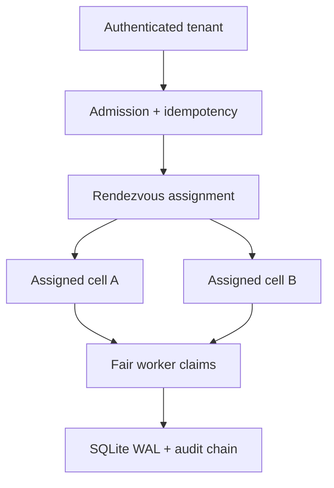

# CellGuard

CellGuard is a working Python/SQLite reliability lab for containing noisy-neighbor and poison-work failures in a multi-tenant queue. It combines deterministic zone-aware shuffle sharding, cell health and capacity gates, per-tenant admission, fair scheduling, durable retries, expiring capability leases, fencing tokens, idempotent submission/completion, and integrity verification.

It is an **independent educational implementation inspired by a documented AWS engineering challenge**. It is not Amazon or AWS code, a Route 53 reproduction, or evidence of production use.

## Sourced problem

AWS Principal Engineer Colm MacCárthaigh documents why a pooled multi-tenant fleet can fail badly: a request flood or poison request can follow ordinary failover, cascade through all workers, and affect every customer. In the eight-worker example, four fixed two-worker shards reduce the fully shared failure domain from 100% to 25%. [Workload isolation using shuffle-sharding](https://builder.aws.com/content/3F06NpJ8YeoIGP8VHTw4n81pFn8/workload-isolation-using-shuffle-sharding)

AWS's shuffle-sharding pattern overlaps small virtual shards. Choosing two workers from eight gives 28 unordered combinations, so the simplified fully overlapping failure domain becomes 1/28 instead of 1/4. The article says Route 53 applies this at much larger scale: four of 2,048 virtual name servers give roughly 730 billion possible shards. AWS also describes stateless hash assignment, stateful overlap-aware assignment, availability-zone-aware placement, and applicability to queues, rate limiters, and locks. [AWS Architecture Blog](https://aws.amazon.com/blogs/architecture/shuffle-sharding-massive-and-magical-fault-isolation/)

The [AWS Well-Architected Framework](https://docs.aws.amazon.com/wellarchitected/2022-03-31/framework/rel_fault_isolation_use_bulkhead.html) calls service bulkheads “cells”: the goal is to contain a failure to a limited subset of clients or requests so most can continue.

### Documented facts versus project inference

| Category | Statement |
| --- | --- |
| Documented by AWS | A flood or poison request can cascade across a pooled fleet; fixed and shuffle shards reduce shared failure scope. |
| Documented by AWS | Eight workers have 28 possible unordered two-worker combinations; the AWS example compares 1/28 full overlap with 1/4 for four fixed shards. |
| Documented by AWS | Stateless hashing, overlap-aware assignment, zone-aware placement, and queue isolation are useful forms of the pattern. |
| Project inference | A durable work queue makes noisy admission, starvation, worker death, stale completion, and cell failure locally testable. |
| Independent design | CellGuard uses salted rendezvous hashing, eight logical SQLite-backed cells, two-cell cross-zone assignments, per-tenant limits, round-robin claims, HMAC lease capabilities, and fencing. These are lab choices, not claims about AWS internals. |

See [docs/SOURCES.md](docs/SOURCES.md) for source-to-design traceability.

## Business impact

A single bulk customer can otherwise fill a shared queue, consume every worker slot, or repeatedly trigger faulty work. Healthy tenants then suffer latency and availability loss even though their requests are unrelated. An expired worker can also finish after a replacement and duplicate an external side effect.

CellGuard demonstrates a containment boundary:

- each tenant can use only its deterministic two-cell shard;
- one tenant has bounded outstanding and in-flight work;
- a healthy assigned cell absorbs work when its peer fails;
- a full shard fails closed instead of spreading overload into every cell;
- round-robin weighted claims keep another tenant schedulable inside a shared cell;
- idempotency makes ambiguous submit/completion retries safe;
- lease capabilities and higher fencing tokens reject stale workers;
- persistent assignment and hash-chain checks surface corruption or unintended shard escape.

## Architecture



The topology has eight cells in four zones. Assignment ranks cells using SHA-256 over `(salt, tenant, cell)` and chooses two different zones when possible. IDs are sorted before the assignment digest is stored. Changing topology produces a new epoch; opening an existing database under another epoch or lease-secret fingerprint fails.

Submission is one `BEGIN IMMEDIATE` transaction: validate bounded JSON, establish policy and assignment, replay or bind the idempotency key, enforce tenant and cell capacity, choose the least-loaded healthy assigned cell, append audit state, and commit. A draining cell may finish queued work but receives no new work; an unhealthy cell cannot admit or claim.

Workers claim jobs per cell. Tenants rotate through a durable cursor; each round grants up to its weight while enforcing a global tenant in-flight limit. A claim stores only the HMAC of a random capability, increments its fence, and establishes an expiry. Expiry requeues below `max_attempts` and dead-letters at the limit.

## Correctness and security properties

- **Containment:** every persisted job's cell must belong to its tenant's deterministic assignment. No automatic global spillover exists.
- **Noisy-neighbor admission:** tenant outstanding/in-flight limits are independent of cell capacity and other tenants' quotas.
- **Fairness:** weighted round-robin works across eligible tenants; priority orders only one tenant's jobs, preventing global priority starvation.
- **Idempotency:** `(tenant, idempotency_key)` replays the original job. Changing payload or priority is a conflict. Completion replay requires the original capability and result digest.
- **Worker recovery:** attempts and fencing tokens only increase. An expired lease capability cannot complete after reallocation.
- **Durability/integrity:** foreign keys, synchronous SQLite WAL, assignment epochs/digests, payload/result hashes, and a linked audit hash chain are verified.
- **Tenant boundary:** the HTTP adapter derives tenant identity from a server-side token map, uses a separate worker token, and rejects caller-provided extra fields.
- **Input hardening:** strict UTF-8 JSON, 64 KiB HTTP body cap, 16 KiB canonical payload cap, duplicate-key and non-finite rejection, closed IDs/ranges, parameterized SQL, and generic unexpected-error responses.

Read [SECURITY.md](SECURITY.md) for the trust boundary and production gaps.

## Quick start

Requires Python 3.11+ and no third-party runtime packages.

```bash
cd projects/2026-10-26-cellguard
python -m cellguard demo
python -m unittest discover -s tests -v
python scripts/validate.py
```

Run the controlled benchmark separately:

```bash
python -m cellguard benchmark --jobs 500 --tenants 100
```

Run in a restricted container:

```bash
docker build -t cellguard .
docker run --rm --network none --read-only \
  --tmpfs /tmp:rw,noexec,nosuid,size=128m \
  --cap-drop ALL --security-opt no-new-privileges \
  cellguard
```

## Reproducible demo

The deterministic demo uses synthetic tenants and controlled timestamps. It:

1. assigns 2,400 tenants across eight cells and calculates exact two-cell overlap with one noisy tenant;
2. fills that tenant's 12-job allowance, rejects job 13, and admits four jobs for a tenant sharing the exact shard;
3. claims four jobs from their shared cell in alternating tenant order;
4. marks one assigned cell unhealthy and proves the other receives work;
5. marks both assigned cells unhealthy and proves admission does not escape the shard;
6. expires a lease, reclaims with fence 2, rejects fence 1's stale capability, and completes with the current owner;
7. recomputes every assignment, payload/result digest, state invariant, and 35-link audit chain.

Observed on the checked-in run: 120 of 2,400 tenants (5.00%) had exact full overlap with the noisy tenant. That is 5× smaller than the 25% fixed-shard baseline and 20× smaller than pooled impact in the simplified comparison. It is a finite synthetic result, not a guarantee or AWS measurement.

## Measured local validation

Environment: CPython 3.12.14, SQLite 3.53.1, Linux x86-64. These results are local synthetic measurements, not AWS, Route 53, distributed-cell, or production performance.

| Check | Observed result |
| --- | ---: |
| Automated tests | 54 passed |
| Test time | 5.845 s |
| Demo tenants / fully overlapping | 2,400 / 120 (5.00%) |
| Benchmark jobs / tenants | 500 / 100 |
| Jobs successfully processed | 500 |
| End-to-end throughput | 297.44 jobs/s |
| Submit latency p50 | 1.698 ms |
| Submit latency p95 | 2.096 ms |
| Final integrity scan | 500 jobs, 1,500 audit links verified |

The throughput denominator includes sequential submit plus sequential claim/complete work. It uses eight logical cells in one temporary SQLite database with synchronous durability; it does not model network, replicas, regional latency, or concurrent production traffic. Values vary by machine.

Machine-readable evidence: [validation.json](reports/validation.json), [demo.json](reports/demo.json), and [tests.log](reports/tests.log).

## Local HTTP API

Create distinct random secrets and start the loopback server:

```bash
export CELLGUARD_LEASE_SECRET='replace-with-at-least-32-random-bytes'
export CELLGUARD_WORKER_TOKEN='replace-with-a-different-24+-character-token'
export CELLGUARD_TENANT_TOKENS='{"acme":"replace-with-another-24+-character-token"}'
python -m cellguard serve --database ./runtime/cellguard.sqlite --port 8080
```

| Method | Route | Principal | Purpose |
| --- | --- | --- | --- |
| `GET` | `/healthz` | public | Liveness only |
| `GET` | `/v1/assignment` | tenant | Inspect caller's stable shard |
| `POST` | `/v1/jobs` | tenant | Idempotently submit bounded JSON work |
| `GET` | `/v1/jobs/{job_id}` | tenant | Read caller-owned job state |
| `POST` | `/internal/claims` | worker | Claim eligible work from one cell |
| `POST` | `/internal/jobs/{job_id}/complete` | worker | Commit a capability-bound result |
| `POST` | `/internal/jobs/{job_id}/fail` | worker | Retry or dead-letter a claimed job |

The API intentionally has no remote topology, policy, or cell-health mutation route.

## Repository map

| Path | Responsibility |
| --- | --- |
| `cellguard/topology.py` | Deterministic zone-aware assignment and impact calculation |
| `cellguard/store.py` | Durable admission, fair claims, leases, fencing, retries, audit/integrity |
| `cellguard/api.py` | Strict tenant/worker-authenticated HTTP adapter |
| `cellguard/demo.py` | Fault scenarios and controlled benchmark |
| `tests/` | 54 unit, integration, concurrency, corruption, lease, fairness, demo, and HTTP tests |
| `scripts/validate.py` | One-command machine-readable validation |
| `docs/INTERVIEW.md` | Interview narrative and likely follow-ups |
| `docs/SOURCES.md` | Documented facts separated from project inference |

## Design tradeoffs

- Zone-spread reduces this eight-cell topology from 28 possible pairs to 24, trading some combinatorial isolation for failure-domain diversity.
- Least-loaded admission balances queued work but reads counts transactionally, which is simple rather than optimized for very high write rates.
- Strict no-escape routing preserves blast radius but makes a tenant unavailable if both assigned cells fail. Reserved isolation capacity would be an explicit production mechanism.
- SQLite `BEGIN IMMEDIATE` gives unambiguous local transactions and serializes writers; it is not horizontally scalable.
- Weighted round-robin is explainable and starvation-resistant, but production schedulers may need cost-aware deficit accounting rather than job counts.
- An unkeyed audit hash chain detects accidental/tampered history only if the expected head is externally anchored; an administrator with database write access can rewrite it.
- Lease fencing protects queue completion. External side effects are safe only when their destination also accepts idempotency keys or persists the highest fence.

## Known limits

- Eight cells are logical rows in one SQLite database and one process, not isolated hosts, queues, availability zones, or replicated services.
- Rendezvous rankings change when the cell set changes. There is no online topology migration, dual routing, cell split, or tenant evacuation protocol.
- The demo models exact shard overlap as full impact; real failure propagation depends on traffic, capacity, retry behavior, and failure mode.
- The API uses Python's development-oriented standard-library server and lacks TLS, OIDC, secret rotation, connection budgets, distributed rate limits, and production observability.
- There is no multi-node consensus, replication, scheduler wakeup, cross-process lock service, autoscaling, payload encryption, or external side-effect sink.
- Benchmark calls are sequential and machine-specific. Do not present them as AWS or production figures.

## Resume-ready bullets

- Built an independent Python/SQLite multi-tenant queue inspired by AWS shuffle sharding, implementing deterministic cross-zone two-cell placement, no-escape failover, per-tenant admission, weighted fair claims, durable retries, capability leases, and stale-worker fencing.
- Validated isolation, concurrency, idempotency, integrity, and authenticated HTTP behavior with 54 automated tests plus Python 3.11–3.13/container CI; in a controlled 2,400-tenant scenario measured 5.00% exact shard overlap versus a 25% fixed-shard baseline and processed all 500 local benchmark jobs at 297.44 jobs/s.

For an honest five-minute explanation, use [docs/INTERVIEW.md](docs/INTERVIEW.md).
