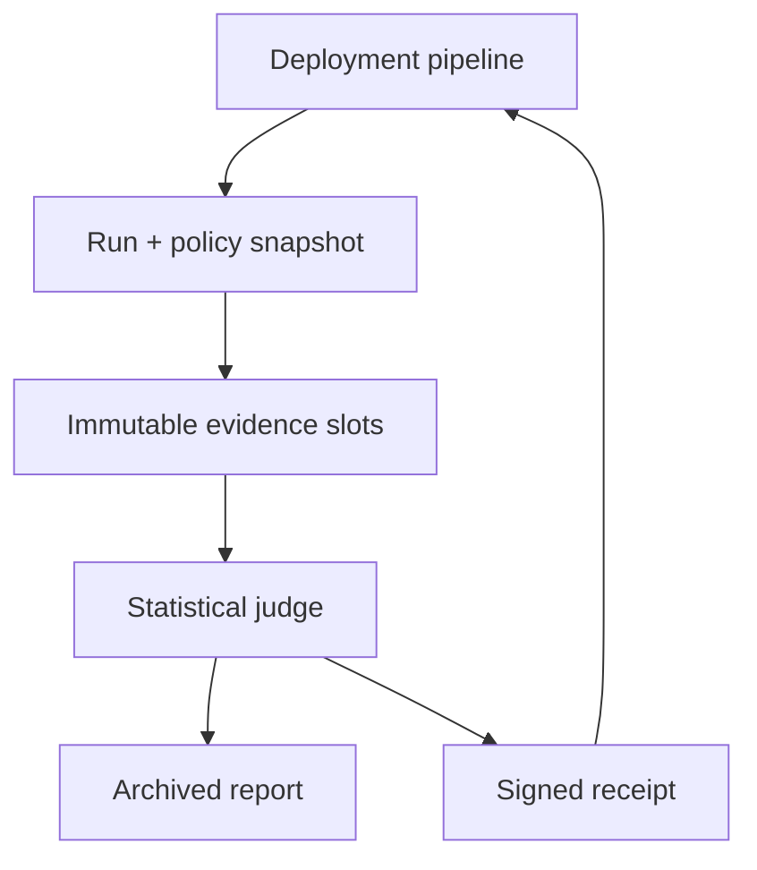

# RolloutJudge

RolloutJudge is a working Python/SQLite laboratory for automated canary-release decisions. It ingests baseline and canary distributions, validates evidence completeness, detects meaningful regressions, controls false discoveries across metrics, archives an explainable verdict, and issues an HMAC-signed receipt that a separate CI/CD controller can verify.

It is an **independent educational implementation inspired by documented Netflix and Google canary-analysis challenges**. It is not Netflix Kayenta, Google CAS, company code, or evidence of production use.

## Sourced problem

Netflix describes canarying as routing a small traffic share to a proposed version beside stable production and comparing key behavior. Its process used production, newly created baseline, and canary clusters; a fresh baseline reduces effects caused by comparing a new canary with long-running processes. [Automated Canary Analysis at Netflix with Kayenta](https://netflixtechblog.com/automated-canary-analysis-at-netflix-with-kayenta-3260bc7acc69)

Netflix reports that manual canary review required several hours of graph and log inspection, made builds more frequent than once or twice weekly difficult, and could miss subtle differences. Kayenta separates metric retrieval from judgment; documented judgment stages include data validation, missing-value cleaning, Mann–Whitney U comparison, score computation, and detailed reporting.

Google defines canarying as a partial and time-limited deployment followed by evaluation and notes that many incidents are triggered by binary or configuration pushes. [Canarying Releases](https://sre.google/workbook/canarying-releases/)

Google's [Canary Analysis Service paper](https://sre.google/static/pdf/canary_analysis.pdf) describes a passive observer that asks whether the canary is meaningfully worse—not whether the service is absolutely healthy—and returns a clear PASS, FAIL, or NONE-style result to a separate rollout tool.

### Documented facts versus project inference

| Category | Statement |
| --- | --- |
| Documented by Netflix | Manual visual comparison was slow, difficult to scale, and weak at subtle-difference detection. |
| Documented by Netflix | Kayenta validates and cleans baseline/canary metrics, uses Mann–Whitney U for comparison, computes a score, and exposes detailed reports. |
| Documented by Google | Canary analysis is a partial/time-limited A/B evaluation; the analysis service can remain passive and return an unambiguous verdict. |
| Project inference | A self-contained backend with durable evidence and signed results is a useful local model for CI/CD correctness, retry ambiguity, policy drift, and telemetry gaps. |
| Independent design | RolloutJudge adds Benjamini–Hochberg correction, absolute-plus-relative median guardrails, four verdicts, policy snapshots, optimistic judgment fencing, HMAC receipts, and SQLite audit verification. These are lab choices, not claims about company internals. |

See [docs/SOURCES.md](docs/SOURCES.md) for detailed source-to-design traceability.

## Business impact

A weak canary gate creates two expensive outcomes. A false negative promotes a regression to more customers, increasing errors, latency, rollback cost, and incident risk. A false positive repeatedly blocks healthy releases, slows delivery, and teaches engineers to distrust or bypass automation. Missing telemetry interpreted as success is especially dangerous.

RolloutJudge demonstrates a safer decision boundary:

- immutable policy snapshots keep the evaluation contract stable during a rollout;
- service-bound idempotency makes lost create, ingest, and judgment acknowledgements safe to retry;
- declared trial/metric slots make coverage explicit;
- statistical evidence and practical effect thresholds must both indicate degradation;
- critical regressions override an otherwise acceptable score;
- missing expected evidence produces INCONCLUSIVE instead of a false PASS;
- PASS, FAIL, MANUAL, and INCONCLUSIVE preserve operational meaning;
- signed, archived receipts let a separate deployment system verify exactly what was judged;
- digest and HMAC-chain verification detects changes to evidence, policies, reports, materialized scores, receipts, or audit history.

## Architecture



RolloutJudge intentionally never changes production. The rollout system creates baseline/canary populations and supplies evidence; this service acts as a passive judge.

### Judgment pipeline

1. Authenticate a service and idempotently start a run with a release, policy, and expected trials.
2. Snapshot the policy document, digest, and version into the run.
3. Accept exactly one immutable dataset for every `(trial, metric)` slot; a batch-key replay must have the same digest.
4. Require the caller's current run version before judgment so newly committed evidence cannot be accidentally ignored.
5. Apply each metric's `drop` or `zero` missing-data semantics and enforce minimum sample count and completeness.
6. Compare baseline and canary distributions using a tie-corrected Mann–Whitney U normal approximation.
7. Apply Benjamini–Hochberg adjusted p-values across comparisons.
8. Mark a regression only when statistical significance and both absolute and relative median guardrails are crossed in the harmful direction.
9. Fail on any critical regression or a score below the manual threshold; otherwise return INCONCLUSIVE for missing evidence, PASS above the pass threshold, or MANUAL between thresholds.
10. Atomically store the report and HMAC receipt with the final run version.

## Correctness and security properties

- **Policy immutability:** every run contains its own validated policy snapshot and digest; later updates affect only new runs.
- **Evidence immutability:** a trial/metric slot cannot be overwritten. A retry under the same batch key must match byte-equivalent canonical evidence.
- **Optimistic judgment:** a compare-and-set run version rejects a decision made against stale evidence state.
- **Idempotent terminal decision:** replaying the same decision key returns the identical report and receipt; a different key conflicts.
- **Fail-closed coverage:** absent, incomplete, or excessively missing evidence cannot produce PASS.
- **Multiple-testing control:** adjusted p-values reduce the expected false-discovery proportion when many metrics are judged together.
- **Practical significance:** large samples cannot fail a release solely because of a tiny statistically detectable shift.
- **Service boundary:** HTTP identity comes from a server token map; runs and receipt verification are service-scoped.
- **Integrity:** SQLite foreign keys/WAL, SHA-256 content digests, HMAC audit links, and signed receipts are recomputed by `verify`.
- **Strict input:** closed identifiers, finite/ranged numeric arrays, bounded JSON, duplicate/unknown field rejection, media-type enforcement, and parameterized SQL.

Read [SECURITY.md](SECURITY.md) for threat and statistical boundaries.

## Quick start

Requires Python 3.11+ and no third-party runtime packages.

```bash
cd projects/2026-10-27-rolloutjudge
python -m rolloutjudge demo
python -m unittest discover -s tests -v
python scripts/validate.py
```

Run the controlled benchmark:

```bash
python -m rolloutjudge benchmark --analyses 100
```

Run in a restricted container:

```bash
docker build -t rolloutjudge .
docker run --rm --network none --read-only \
  --tmpfs /tmp:rw,noexec,nosuid,size=128m \
  --cap-drop ALL --security-opt no-new-privileges \
  rolloutjudge
```

## Reproducible demo

The deterministic demo uses four metrics (`latency_ms`, `error_rate`, `cpu_ratio`, and `throughput_rps`), two synthetic zones, and 60 values per arm and metric. It produces:

| Scenario | Evidence | Score | Verdict |
| --- | --- | ---: | --- |
| Safe | 8/8 checks; no meaningful regression | 100 | PASS |
| Failed | Latency and errors regress in both zones | 50 | FAIL |
| Manual | Noncritical CPU regresses in both zones | 75 | MANUAL |
| Inconclusive | Error-rate evidence absent in both zones | 100 among available metrics | INCONCLUSIVE |

The demo also safely replays a lost evidence acknowledgement, rejects changed content under the same key, returns an identical archived judgment on retry, validates the signed PASS receipt, rejects a tampered FAIL receipt, and verifies 31 evidence sets plus 41 HMAC-linked audit entries.

## Measured local validation

Environment: CPython 3.12.14, SQLite 3.53.1, Linux x86-64. These are local sequential synthetic measurements—not Netflix, Google, Kayenta, CAS, distributed storage, or production traffic.

| Check | Observed result |
| --- | ---: |
| Automated tests | 67 passed |
| Test time | 6.295 s |
| Benchmark analyses | 100/100 passed |
| Synthetic numeric observations | 48,000 |
| Immutable evidence sets | 400 |
| End-to-end analysis throughput | 51.51 analyses/s |
| Judgment latency p50 | 3.607 ms |
| Judgment latency p95 | 5.459 ms |
| Final integrity scan | 100 runs, 400 evidence sets, 601 audit entries verified |

Each benchmark analysis durably creates one run, writes four evidence transactions containing 60 baseline and 60 canary values each, reads the current version, and archives one judgment. The throughput timer excludes the final whole-database integrity scan. Values vary by machine and should not be used as a capacity promise.

Machine-readable evidence: [validation.json](reports/validation.json), [demo.json](reports/demo.json), and [tests.log](reports/tests.log).

## Local HTTP API

Initialize the default policy, then start the loopback server with distinct random secrets:

```bash
export ROLLOUTJUDGE_SIGNING_SECRET='replace-with-at-least-32-random-bytes'
python -m rolloutjudge init ./runtime/rolloutjudge.sqlite

export ROLLOUTJUDGE_SERVICE_TOKENS='{"checkout":"replace-with-a-distinct-24+-character-token"}'
python -m rolloutjudge serve --database ./runtime/rolloutjudge.sqlite --port 8080
```

| Method | Route | Purpose |
| --- | --- | --- |
| `GET` | `/healthz` | Liveness only |
| `POST` | `/v1/runs` | Idempotently start a service-bound analysis |
| `GET` | `/v1/runs/{run_id}` | Read evidence coverage, report, and receipt |
| `POST` | `/v1/runs/{run_id}/evidence` | Store one immutable trial/metric dataset |
| `POST` | `/v1/runs/{run_id}/judge` | Version-fenced terminal judgment |
| `POST` | `/v1/receipts/verify` | Verify a receipt belongs to the authenticated service |

Policy administration is deliberately CLI/library-only in this lab; it is not exposed through the service endpoint.

## Repository map

| Path | Responsibility |
| --- | --- |
| `rolloutjudge/model.py` | Policy, metric, identifier, numeric-series, and JSON validation |
| `rolloutjudge/judge.py` | Mann–Whitney U, false-discovery adjustment, effect guardrails, scoring |
| `rolloutjudge/store.py` | SQLite state machine, idempotency, policy snapshots, receipts, integrity |
| `rolloutjudge/api.py` | Strict service-bound HTTP boundary |
| `rolloutjudge/demo.py` | Four reproducible verdict scenarios and benchmark |
| `tests/` | 67 model, statistical, concurrency, lifecycle, tamper, API, and demo tests |
| `docs/INTERVIEW.md` | Interview story, likely questions, and honest limits |
| `docs/SOURCES.md` | Documented facts separated from independent design |

## Design tradeoffs

- Mann–Whitney handles non-normal distributions but the local normal approximation is not an exact small-sample implementation and assumes observations are meaningfully independent.
- Benjamini–Hochberg is understandable and useful across many metrics, but correlated metrics and repeated peeking still complicate false-positive control.
- Requiring both absolute and relative effect limits avoids near-zero and huge-sample traps, but thresholds require domain knowledge and ongoing calibration.
- INCONCLUSIVE preserves the difference between unsafe and unknown; pipelines must nevertheless treat every non-PASS verdict as no-promotion.
- Immutable evidence makes audit/retry semantics simple. Correcting bad source data requires a new analysis rather than an in-place edit.
- Policy snapshots protect reproducibility at the cost of storing duplicate configuration documents.
- HMAC receipts are portable and deterministic but use a shared secret; asymmetric, versioned KMS signing is preferable across trust domains.
- SQLite immediate transactions make concurrency behavior unambiguous locally but serialize writers and do not provide multi-region availability.

## Known limits

- Evidence is caller-supplied; there is no Atlas, Prometheus, Datadog, or traffic-router integration and no proof that baseline/canary populations are comparable.
- There is no time-window alignment, burn-in period, sample-ratio mismatch detector, seasonality control, autocorrelation correction, or sequential-test alpha spending.
- The implementation judges medians and distributions but does not understand SLO budgets, user cohorts, dependent metrics, or business KPIs automatically.
- It does not create clusters, route traffic, promote releases, or execute rollback. It is intentionally a passive observer.
- One process and SQLite file are not replicated production infrastructure. The HTTP server lacks TLS/OIDC, distributed quotas, tracing, and secret rotation.
- Local benchmark numbers are sequential and machine-specific. Do not present them as Netflix, Google, or production performance.

## Resume-ready bullets

- Built an independent Python/SQLite canary-analysis backend inspired by Netflix Kayenta and Google CAS, implementing policy snapshots, immutable metric evidence, tie-corrected Mann–Whitney comparisons, false-discovery control, practical effect guardrails, and four explainable rollout verdicts.
- Validated service isolation, concurrent idempotency, stale-version rejection, missing-data fail-closed behavior, signed receipts, and tamper detection with 67 automated tests and reproducible CI; processed 100 local analyses containing 48,000 synthetic observations at 51.51 analyses/s.

Use [docs/INTERVIEW.md](docs/INTERVIEW.md) for an honest five-minute walkthrough.
