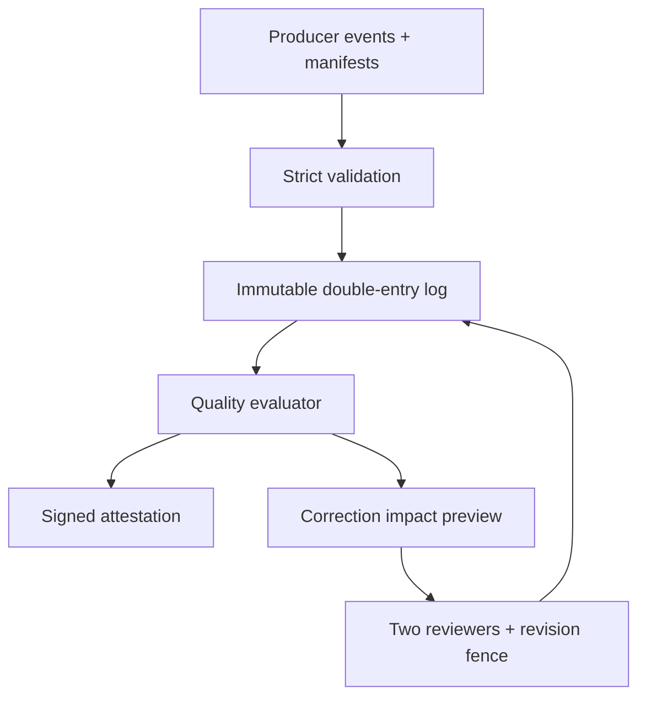

# ClearFlow

ClearFlow is a working Python/SQLite laboratory for proving the quality of money-movement data. It stores balanced fund-flow events in an immutable hash chain, reconciles out-of-order lifecycle steps, evaluates clearing, timeliness, and completeness, signs quality reports, and applies corrections only as reviewed compensating entries.

It is an **independent educational implementation inspired by Stripe's documented Ledger and Data Quality challenge**. It is not Stripe Ledger, Stripe code, a payment processor, an accounting product, or evidence of production use.

## Sourced problem

Stripe's February 16, 2024 engineering article, [Ledger: Stripe's system for tracking and validating money movement](https://stripe.com/blog/ledger-stripe-system-for-tracking-and-validating-money-movement), describes a network of internal services, banks, and payment methods with different interfaces, data models, delivery cadences, and definitions of correctness. Stripe needs to prove that those independently operated systems collectively represent financial activity correctly.

The article documents these design ideas:

- an immutable, auditable event log is the financial system of record;
- producer state machines can be represented as logical fund flows between accounts;
- double-entry bookkeeping makes unbalanced movement mathematically observable;
- lifecycle events may arrive independently and out of order, while a missing event or wrong identifier leaves a clearing balance nonzero;
- data quality is evaluated through clearing, timeliness, and completeness;
- corrections append reversals and reprocessed operations rather than mutating history;
- repair operations receive an out-of-band impact report and a two-phase review and commit.

See [docs/SOURCES.md](docs/SOURCES.md) for source-to-design traceability and the separation between documented facts and project inference.

## Business impact

Financial pipelines can appear operational while silently containing a missing release, late bank report, wrong merchant identifier, duplicated delivery, or unsafe manual correction. Those faults can produce wrong balances, delayed reports, unexplained money movement, and expensive audit investigations.

ClearFlow demonstrates a bounded decision system:

- integer minor units avoid floating-point money errors;
- every event must balance to zero before storage;
- immutable account postings reconstruct balances at any point in time;
- producer manifests make missing source records explicit;
- clearing accounts expose incomplete or incorrectly joined lifecycle steps;
- event timestamps expose late delivery;
- signed quality attestations bind a decision to an exact report and revision;
- proposed corrections preview account-level impact and require two reviewers;
- revision fencing invalidates approval if the ledger changes before execution;
- corrections append a reversal and replacement atomically;
- hash-chain verification detects detached, corrupted, or rewritten evidence.

## Architecture



ClearFlow remains an observer and evidence store. It does not contact banks, move real money, or mutate a source payment system.

### Fund-flow model

A creation event moves 10,000 minor units from a terminal network account into a per-charge clearing account:

| Account | Posting |
| --- | ---: |
| `network:cash` | -10,000 |
| `pending:charge-1` | +10,000 |

A release event empties the clearing account and divides the value between merchant availability and platform fees:

| Account | Posting |
| --- | ---: |
| `pending:charge-1` | -10,000 |
| `merchant:available` | +9,700 |
| `platform:fees` | +300 |

Both events independently sum to zero. They can arrive in either order because the shared account identifier connects them. If release uses `pending:charge-2`, both clearing accounts remain nonzero and the quality gate fails.

### Quality evaluation

At an `as_of` timestamp, ClearFlow reads one SQLite snapshot and calculates:

1. **Clearing:** active clearing accounts older than the grace period must equal zero.
2. **Timeliness:** `received_ns - occurred_ns` must remain within policy.
3. **Completeness:** every reference declared by a due producer manifest must exist.
4. **Verdict:** a policy breach returns `FAIL`; absent events or due manifests returns `INCONCLUSIVE`; only complete evidence returns `PASS`.
5. **Attestation:** tenant, evaluation, revision, score, verdict, and report digest are HMAC-signed.

### Correction protocol

1. An author proposes a balanced replacement for an existing event.
2. ClearFlow computes affected account balances before and after reversal plus replacement.
3. The preview digest and current ledger revision are frozen into the proposal.
4. Two distinct reviewers—not the author—approve that exact digest.
5. Execution compares the current and preview revisions.
6. One transaction appends a reversal and replacement; the original remains immutable.
7. A lost execution acknowledgement can be retried with the same key and returns the archived result.

## Correctness and security properties

- **Exact arithmetic:** amounts are bounded signed integers in currency minor units; booleans, floats, zeros, and non-finite values are rejected.
- **Balanced transactions:** 2–64 unique account postings must sum exactly to zero.
- **Currency boundary:** every posting account must exist in the tenant and match the event currency.
- **Append-only history:** SQLite triggers reject event or posting update/delete; corrections add new events.
- **Retry safety:** event, manifest, evaluation, proposal, and execution idempotency keys bind to canonical request digests.
- **Tenant isolation:** HTTP identity comes only from a server-side bearer-token map and all reads/writes are tenant-scoped.
- **Fail-closed quality:** missing evidence cannot produce `PASS`.
- **Separation of duties:** an author cannot self-approve; two independent actors must approve one preview digest.
- **Optimistic correction:** any intervening ledger event invalidates the impact preview.
- **Tamper evidence:** per-tenant HMAC-SHA-256 event and audit chains, report digests, signed attestations, and full integrity replay are verified.
- **Strict boundary:** closed JSON schemas, duplicate-field rejection, 1 MiB request limit, UTF-8 enforcement, bounded identifiers, parameterized SQL, loopback-only serving, and defensive response headers.

Read [SECURITY.md](SECURITY.md) for the threat model and production gaps.

## Quick start

Requires Python 3.11+ and no third-party runtime packages.

```bash
cd projects/2026-10-28-clearflow
python -m clearflow demo
python -m unittest discover -s tests -v
python scripts/validate.py
```

Run the controlled benchmark:

```bash
python -m clearflow benchmark --flows 200
```

Run in a restricted container:

```bash
docker build -t clearflow .
docker run --rm --network none --read-only \
  --tmpfs /tmp:rw,noexec,nosuid,size=128m \
  --cap-drop ALL --security-opt no-new-privileges \
  --pids-limit 128 \
  clearflow
```

## Reproducible demonstration

The deterministic demo uses four isolated synthetic tenants:

| Scenario | Evidence | Result |
| --- | --- | --- |
| Out-of-order healthy flow | Release arrives before creation but both use the same clearing ID | `PASS`, score 100 |
| Wrong clearing dimension | Creation and release use different pending accounts | `FAIL`, two uncleared accounts |
| Reviewed correction | Two reviewers approve reversal plus corrected replacement | Returns to `PASS` |
| Missing release | Manifest expects two references but only creation arrives | `FAIL`, one missing reference |
| Late release | Complete and balanced, but delivery exceeds the lag policy | `FAIL`, one late event |

The demo also rejects author self-approval, safely replays lost event and correction acknowledgements, rejects changed idempotent input, validates a signed attestation, rejects a modified attestation, and replays every event/audit hash.

## Measured local validation

Recorded environment: CPython 3.12.14, SQLite 3.53.1, Linux x86-64. These are local sequential synthetic measurements—not Stripe infrastructure, payment volume, financial accuracy certification, or production capacity.

| Check | Observed result |
| --- | ---: |
| Automated tests | 88 passed in 9.140 s |
| Benchmark fund flows | 200/200 passed |
| Immutable events | 400 |
| Double-entry postings | 1,000 |
| End-to-end ingestion | 365.39 flows/s |
| Two-event flow latency | p50 1.835 ms; p95 2.733 ms |
| Quality evaluation | 3.995 ms |
| Integrity replay | 16.168 ms |
| Verified state | 203 accounts, 400 events, 1,000 postings, 605 audit entries |

The throughput timer includes account creation, two separately committed events per flow, a 400-reference manifest, and one final quality evaluation. It excludes the subsequent whole-database integrity replay. Results vary by filesystem and machine and are not a capacity promise.

Machine-readable evidence is committed under [`reports/`](reports/).

## Local HTTP API

Supply a secret of at least 32 bytes and distinct tenant tokens of at least 24 characters:

```bash
export CLEARFLOW_SIGNING_SECRET='replace-with-at-least-32-random-bytes'
export CLEARFLOW_TENANT_TOKENS='{"demo-shop":"replace-with-a-distinct-24+-character-token"}'
python -m clearflow serve ./runtime/clearflow.sqlite --port 8080
```

| Method | Route | Purpose |
| --- | --- | --- |
| `GET` | `/healthz` | Liveness only; exposes no database state |
| `POST` | `/v1/accounts` | Register a tenant-scoped clearing or terminal account |
| `POST` | `/v1/events` | Idempotently append a balanced immutable event |
| `GET` | `/v1/events/{event_id}` | Read one tenant-scoped event and postings |
| `GET` | `/v1/balances` | Reconstruct current account balances |
| `POST` | `/v1/manifests` | Declare expected producer references and deadline |
| `POST` | `/v1/quality/evaluations` | Archive a snapshot report and signed attestation |
| `POST` | `/v1/quality/attestations/verify` | Verify a report belongs to the authenticated tenant |
| `GET` | `/v1/stats` | Read tenant-scoped materialized counts |

Correction operations are deliberately library/admin-only in this lab. The basic tenant bearer token does not authenticate individual human reviewers, so exposing those operations through it would make the two-reviewer rule meaningless. A production correction API needs OIDC-backed reviewer identities and authorization policy.

## Repository map

| Path | Responsibility |
| --- | --- |
| `clearflow/model.py` | Closed schemas, exact monetary values, canonical JSON, policy validation |
| `clearflow/store.py` | SQLite ledger, hash chains, manifests, DQ evaluation, corrections, integrity replay |
| `clearflow/api.py` | Tenant-bound strict HTTP interface |
| `clearflow/demo.py` | Deterministic failure scenarios and controlled benchmark |
| `tests/` | 88 model, accounting, concurrency, integrity, correction, HTTP, and demo tests |
| `docs/SOURCES.md` | Primary-source facts separated from project inference |
| `docs/INTERVIEW.md` | Five-minute demo, likely questions, and honest limits |

## Design tradeoffs

- Integer minor units are exact for currencies with fixed scales, but a production ledger needs versioned currency/asset metadata and explicit rounding policies.
- Double-entry proves conservation inside the modeled boundary; it cannot prove a bank actually transferred funds or that producer input is truthful.
- A clearing balance reveals incomplete or mismatched flow stages, but zero can still result from offsetting errors. Completeness and source reconciliation remain necessary.
- Global per-tenant revision fencing makes correction previews easy to reason about but can cause retries during unrelated high-volume activity. Production systems may fence only affected partitions.
- HMAC signatures are simple and deterministic but share one secret. Cross-domain verification should use versioned asymmetric keys backed by KMS/HSM.
- SQLite `BEGIN IMMEDIATE` gives clear local serializability and crash behavior but serializes writers and provides no multi-region availability.
- A single arithmetic mean makes the demo score transparent; real DQ policy needs calibrated weights, materiality, aging buckets, ownership, and exception workflows.

## Known limits

- No real bank, card network, payment API, settlement file, accounting close, or external reconciliation integration is present.
- Producer manifests are trusted declarations; there is no CDC watermark, source database connector, schema registry, or statistical arrival model.
- The HTTP server lacks TLS, OIDC, rotation, distributed quotas, tracing, and a production application server.
- Account provisioning is not a full chart-of-accounts workflow and there are no period locks, exchange rates, taxes, disputes, or multi-leg settlement rules.
- Corrections cannot be canceled and require a fresh proposal after any ledger revision.
- Hash chains detect changes when verified; they do not prevent a privileged attacker from replacing the database and secret together. External checkpoints are needed.
- Benchmark results are sequential and machine-specific. Do not present them as Stripe or production performance.

## Resume-ready bullets

- Built an independent Python/SQLite fund-flow data-quality backend inspired by Stripe Ledger, implementing immutable double-entry events, out-of-order clearing, producer completeness manifests, timeliness gates, signed quality attestations, and append-only corrections.
- Validated idempotency, concurrent retries, tenant isolation, separation of duties, revision-fenced repairs, and tamper detection with 88 automated tests; processed 200 synthetic flows containing 400 events and 1,000 postings at 365.39 flows/s in a controlled local run.

Use [docs/INTERVIEW.md](docs/INTERVIEW.md) for an honest interview walkthrough.
