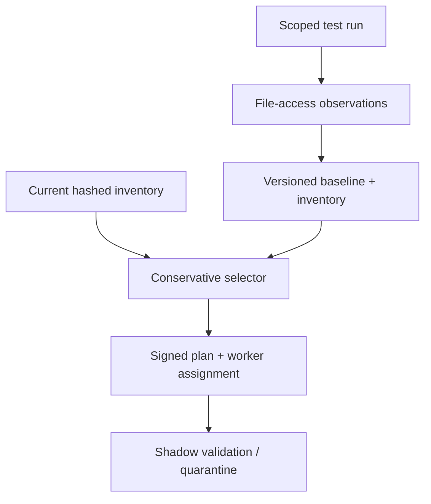

# TestSieve

TestSieve is a working Python/SQLite laboratory for conservative selective test execution. It records which repository files each test reads, versions a complete file inventory, calculates an impacted subset, signs every decision, and automatically falls back to the full suite when evidence is stale, incomplete, global, or quarantined.

It is an **independent educational implementation inspired by Stripe's documented Selective Test Execution challenge**. It is not Stripe code, a Stripe product, a claim of production use, or a reimplementation of Stripe's infrastructure.

## Sourced problem

Stripe's April 9, 2026 engineering article, [Selective Test Execution at Stripe: Fast CI for a 50M-line Ruby monorepo](https://stripe.dev/blog/selective-test-execution-at-stripe-fast-ci-for-a-50m-line-ruby-monorepo), documents a monorepo of roughly 50 million Ruby lines, about 100,000 test files and 1.2 million test units. A sequential full-suite build would take about four months, while Stripe runs around 50,000 builds each week. Stripe reports that its STE system runs about 5% of the suite on average, with a 0.5% median, using less than 10% of the compute of an always-run-everything strategy.

The article explains why the core problem is correctness rather than merely speed:

- Ruby metaprogramming, runtime configuration, fixtures, generated files, and other non-code inputs make complete static dependency prediction difficult.
- Underselection can let a faulty change pass; overselection erodes the CI savings.
- Stripe observes file opens at runtime and associates them with test scopes, then inverts the data into a file-to-test selection index.
- A full hashed file inventory includes generated files, so the decision is not limited to Git-tracked changes.
- Root-scope dependencies force broad execution; directory-discovery tests are mandatory; previously failing tests rerun.
- A recent, completed, coherently versioned baseline makes decisions deterministic and debuggable.

See [docs/SOURCES.md](docs/SOURCES.md) for source-to-design traceability and a strict separation between Stripe-documented facts and TestSieve design inferences.

## Business impact

Large suites create a three-way tension: feedback latency slows engineers, brute-force parallelism increases infrastructure cost, and unsafe selection can merge regressions. TestSieve demonstrates a fail-closed decision boundary: optimization is enabled only after shadow evidence is clean, every decision names its exact baseline, and uncertain evidence expands work to the full suite.

## Architecture



### Decision lifecycle

| Mode | Execution | Purpose |
| --- | --- | --- |
| `RECORD` | Full suite | Build or refresh observation evidence while computing the candidate subset for inspection |
| `SHADOW` | Full suite | Compare real failures with tests the candidate algorithm would have skipped |
| `SELECT` | Candidate subset | Optimize only after two clean shadow runs against the active baseline |

A shadow false negative atomically quarantines the baseline, resets clean-shadow evidence, and returns the repository to `RECORD`. Publishing a new monotonic baseline also resets rollout state.

### Selection algorithm

1. Normalize and hash the current inventory, including generated files supplied by the caller.
2. Compare it with the immutable baseline inventory to find added, changed, and deleted paths.
3. Invert observed `test -> files` edges and union observers of every changed path.
4. Always add mandatory, previously failing, and unmapped tests.
5. Run the full suite if a changed path has no observation, a root dependency changed, the baseline is stale, or the baseline is quarantined.
6. Assign the resulting run set to workers with deterministic longest-processing-time scheduling.
7. HMAC-sign the repository, selection identity, baseline revision/digest, inventory digest, mode, and decision digest.

### Persistence and retry safety

- SQLite `BEGIN IMMEDIATE` serializes publication, selection, shadow validation, and state transitions.
- Repository-scoped idempotency keys bind to canonical request digests; changed retry input returns a conflict.
- Baseline revisions are contiguous and parent-linked; only completed snapshots can become the head.
- Triggers make baseline evidence and selection decisions immutable.
- An HMAC hash chain covers every state-changing audit entry.
- Whole-database verification recomputes request, snapshot, decision, inventory, manifest, shadow-result, and audit links.

## Correctness and security properties

- **Fail closed:** unknown changed files, global dependencies, stale data, unmapped tests, and quarantined evidence broaden execution.
- **No sticky hidden failure:** previously failing tests and mandatory discovery tests remain in every candidate set.
- **Safe rollout:** two clean full-suite shadow comparisons are required before selection mode.
- **Automatic containment:** one observed skipped failure quarantines the current baseline.
- **Reproducible input:** the manifest binds a decision to an immutable baseline snapshot and exact current inventory.
- **Retry convergence:** concurrent retries with one key create one selection identity.
- **Repository isolation:** HTTP identity comes from a server-side bearer-token map; callers cannot choose a repository in request JSON.
- **Strict boundary:** closed schemas, duplicate-key and non-finite JSON rejection, normalized relative paths, bounded objects, a 4 MiB body limit, UTF-8 enforcement, loopback-only serving, parameterized SQL, and defensive headers.
- **Tamper evidence:** HMAC-signed manifests and chained audit entries are checked with constant-time signature comparison.

Read [SECURITY.md](SECURITY.md) for the threat model and production gaps.

## Quick start

Requires Python 3.11+ and no third-party runtime packages.

```bash
cd projects/2026-10-30-testsieve
python -m testsieve demo
python -m unittest discover -s tests -v
python scripts/validate.py
```

Run the controlled synthetic benchmark:

```bash
python -m testsieve benchmark --selections 200
```

Run in a restricted container:

```bash
docker build -t testsieve .
docker run --rm --network none --read-only \
  --tmpfs /tmp:rw,noexec,nosuid,size=128m \
  --cap-drop ALL --security-opt no-new-privileges \
  --pids-limit 128 testsieve
```

## Reproducible demonstration

The deterministic five-test demo proves the complete safety lifecycle:

| Scenario | Expected result |
| --- | --- |
| Two clean shadow runs | `SELECT` becomes eligible |
| `lib/payments.py` changes | 3/5 candidates: impacted payment, mandatory discovery, and prior failure |
| Same selection request is retried | Same selection identity is returned |
| Root runtime changes | Full suite |
| Unobserved generated file appears | Full suite |
| Signed manifest is modified | Rejected |
| Shadow-only skipped refund test fails | Baseline quarantined; next run is full suite |
| Integrity replay | 1 baseline, 7 selections, 3 shadow results, and 14 audit entries verified |

## Measured local validation

Recorded environment: CPython 3.12.14, SQLite 3.53.1, Linux x86-64. These are local sequential synthetic measurements—not Stripe infrastructure, production CI traffic, or a capacity promise.

| Check | Observed result |
| --- | ---: |
| Bytecode compilation | passed |
| Automated tests | 94 passed in 10.774 s |
| Synthetic suite / inventory | 1,000 tests / 1,251 files |
| Changed files / candidate tests | 4 / 22 (2.2%) |
| Selection requests | 200 |
| Selection throughput | 110.60 requests/s |
| Selection latency | p50 8.827 ms; p95 10.472 ms |
| Eight-worker estimated-load spread | 6 ms |
| Whole-state integrity scan | 296.420 ms |
| Verified benchmark state | 1 baseline, 202 selections, 2 shadow results, 207 audit entries |

The selection timer includes one SQLite transaction, dependency inversion, decision persistence, signed manifest creation, and chained audit append per request. The integrity scan is timed separately. Results vary by filesystem and machine. Machine-readable evidence is committed under [`reports/`](reports/).

## Local HTTP API

Provide a secret of at least 32 bytes and distinct repository tokens of at least 24 characters:

```bash
export TESTSIEVE_SIGNING_SECRET='replace-with-at-least-32-random-bytes'
export TESTSIEVE_REPOSITORY_TOKENS='{"checkout-monorepo":"replace-with-a-distinct-24+-character-token"}'
python -m testsieve serve ./runtime/testsieve.sqlite --port 8080
```

| Method | Route | Purpose |
| --- | --- | --- |
| `GET` | `/healthz` | Liveness only; no repository data |
| `POST` | `/v1/baselines` | Publish a completed immutable baseline with revision fencing |
| `GET` | `/v1/baselines/latest` | Read active baseline and rollout state |
| `POST` | `/v1/mode` | Move among `RECORD`, `SHADOW`, and eligible `SELECT` |
| `POST` | `/v1/selections` | Persist an idempotent selection and signed manifest |
| `POST` | `/v1/selections/{id}/shadow-results` | Compare full-run failures with skipped candidates |
| `POST` | `/v1/manifests/verify` | Verify signature, repository binding, and stored decision |
| `GET` | `/v1/stats` | Read repository-scoped counts and rollout state |

The server deliberately binds only to loopback. It is an educational adapter, not an Internet-facing application server.

## Repository map

| Path | Responsibility |
| --- | --- |
| `testsieve/model.py` | Closed schemas, canonical JSON, inventory/test/path validation |
| `testsieve/tracer.py` | Small Python `open`/`os.open` observation adapter for local demos |
| `testsieve/store.py` | Baseline lifecycle, selection, scheduling, shadow safety, signatures, integrity replay |
| `testsieve/api.py` | Repository-bound strict HTTP interface |
| `testsieve/demo.py` | Deterministic lifecycle and 1,000-test benchmark |
| `tests/` | 94 model, tracer, persistence, concurrency, security, HTTP, and demo tests |
| `docs/SOURCES.md` | Primary-source facts separated from project inference |
| `docs/INTERVIEW.md` | Five-minute walkthrough and likely design questions |

## Design tradeoffs

- Dynamic observations capture runtime configuration and fixtures that static imports may miss, but one execution cannot cover every conditional path. Conservative fallbacks and periodic full recording remain necessary.
- A Python-level tracer makes the concept reproducible without native compilation, but it sees only `builtins.open` and `os.open` in the current process. Stripe documents an OS-level interceptor with child-process propagation; TestSieve does not claim that coverage.
- Inverting observations in memory is simple and effective for 1,000 synthetic tests. A large monorepo needs compact persistent indexes, partitioning, caching, and incremental aggregation.
- A full fallback for every unknown changed file favors safety over savings. Production policy may distinguish trusted generators or use richer directory/glob evidence.
- Two clean shadow runs demonstrate the rollout mechanism, not a statistically justified safety threshold. A real deployment needs a longer evidence window and per-repository policy.
- HMAC provides compact local attestations but shares one secret. Cross-service verification should use versioned asymmetric keys backed by KMS/HSM.
- SQLite gives understandable local crash behavior and transactionality, but it is a single-writer, single-node store with no regional availability.

## Known limits

- The project does not instrument syscalls, containers, subprocesses, language runtimes, directory enumeration, network dependencies, environment variables, or database reads.
- Callers provide file digests; TestSieve does not crawl a repository, run Git, or validate generated build output itself.
- There is no real test runner, CI provider integration, remote worker protocol, object storage, bitmap index, baseline garbage collection, or distributed lock.
- Test duration estimates are trusted and LPT scheduling does not model setup affinity, resource classes, flakes, retries, or worker failures.
- The HTTP server lacks TLS, OIDC, quotas, rotation, observability, and a production WSGI/ASGI layer.
- HMAC chains detect stored changes when checked; they cannot prevent a privileged attacker from replacing both database and secret. External checkpoints are required.
- Benchmark data and timings are synthetic and machine-specific. Do not present them as Stripe or production performance.

## Resume-ready bullets

- Built an independent Python/SQLite selective-test backend inspired by Stripe's documented CI challenge, combining runtime file-access observations, hashed inventories, monotonic immutable baselines, fail-closed impact analysis, deterministic worker scheduling, and signed decision manifests.
- Validated concurrent idempotency, mandatory/prior-failure guardrails, full-suite fallbacks, shadow-mode false-negative quarantine, repository isolation, and tamper detection with 94 automated tests; processed 200 selections over a synthetic 1,000-test/1,251-file suite at 110.60 requests/s locally while selecting 22 candidates for four changed files.

Use [docs/INTERVIEW.md](docs/INTERVIEW.md) for an honest interview walkthrough.
