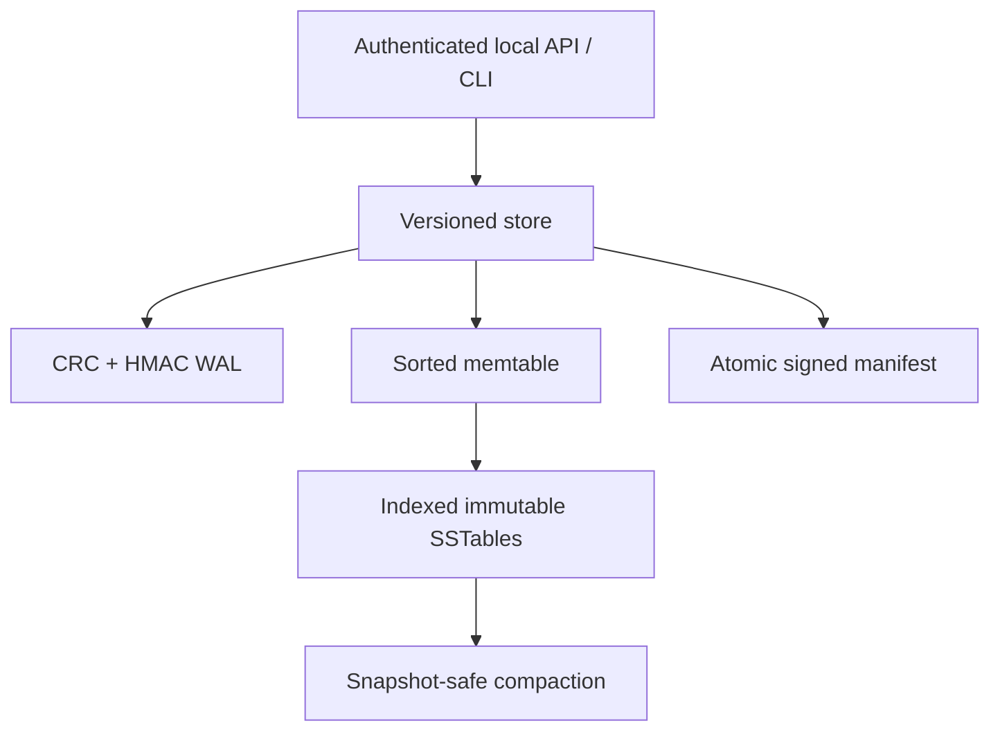

# TabletForge

TabletForge is a working, dependency-free Python laboratory for a crash-recoverable log-structured merge (LSM) storage engine. It implements authenticated write-ahead logging, a versioned memtable, immutable indexed SSTables, Bloom-filtered reads, atomic signed manifests, persistent snapshots, snapshot-safe compaction, idempotent batches, integrity replay, and a strict local HTTP adapter.

It is an **independent educational implementation inspired by Google's documented Bigtable storage design**. It is not Google code, a Google product, a claim of production use, or a reimplementation of the distributed Bigtable service.

## Sourced problem

Google's OSDI 2006 paper, [Bigtable: A Distributed Storage System for Structured Data](https://research.google/pubs/bigtable-a-distributed-storage-system-for-structured-data/) ([official PDF](https://storage.googleapis.com/gweb-research2023-media/pubtools/4443.pdf)), describes a storage system designed for petabytes across thousands of commodity servers and workloads ranging from batch processing to latency-sensitive serving.

The paper's tablet-serving design makes several concrete storage-engine problems visible:

- committed mutations must survive process failure and reconstruct recent state;
- reads must merge newer in-memory state with older immutable files;
- continually flushing memory creates more files and increasing read amplification;
- compaction must reclaim obsolete versions and deletion markers without reviving deleted data;
- negative point lookups should avoid unnecessary SSTable reads; and
- publication order matters: a crash must not make a partially written file authoritative.

The paper documents redo commit logs, a sorted memtable, immutable ordered SSTables, minor and merging compactions, major compaction for deletion reclamation, and Bloom filters to reduce disk work. See [docs/SOURCES.md](docs/SOURCES.md) for page-level traceability and a strict separation between Google-documented facts and TabletForge design inferences.

## Business impact

Storage correctness failures become lost orders, stale profiles, revived deletions, or long recovery windows. At the same time, leaving every immutable file in the read path increases latency and I/O, while retaining obsolete versions wastes capacity and may delay deletion of sensitive data. TabletForge makes those tradeoffs inspectable in a small local system: durability is tested at explicit crash boundaries, read amplification is observable, and compaction is constrained by active snapshot views.

## Architecture



### Write and recovery protocol

1. Validate a closed mutation schema, canonicalize it, and bind the idempotency key to a SHA-256 request digest.
2. Assign contiguous sequence numbers; append one length-delimited WAL frame with CRC32 and HMAC-SHA256; then `fsync` it.
3. Apply the committed records to an in-memory version chain. A retry with the same key and payload returns the original sequence range; changed input conflicts.
4. Flush the sorted memtable to a temporary SSTable, `fsync`, atomically rename it, and `fsync` the segment directory.
5. Publish a new HMAC-signed manifest through its own `fsync` and atomic rename. Only then clear the memtable and reset the WAL.
6. On restart, validate the manifest and referenced segment hashes, quarantine unpublished orphan files, truncate only an incomplete trailing WAL frame, and replay complete frames after the durable checkpoint.

The two simulated crash boundaries are intentional process-exit points. Continuing to use the same in-memory instance after a failpoint is unsupported; the demonstration immediately closes and reopens it.

### Read and compaction protocol

- Point reads select the highest sequence visible to the current view or a named snapshot across the memtable and every segment.
- A segment-level Bloom filter can reject absent keys before record I/O. Min/max key fences avoid probing unrelated segments.
- Scans merge the same versioned view, sort keys, omit tombstones, and enforce bounded result counts.
- Flushes are analogous to minor compaction. Explicit compaction merges all live segments and retains exactly the newest record required by the current view and each active snapshot.
- A tombstone is removed only when no active view needs an older value. Signed manifest publication precedes deletion of obsolete segment files.

## Correctness and security properties

- **Write-ahead durability:** a successful WAL `fsync` is replayable after restart, including an acknowledged simulated crash before memtable application.
- **Publication safety:** unpublished segments are never adopted by filename alone; they are quarantined because the signed manifest is authoritative.
- **No deletion resurrection:** snapshot-aware version retention keeps a tombstone while any retained older value could otherwise become visible.
- **Retry convergence:** one canonical payload per idempotency key maps to one contiguous sequence range across restarts.
- **Corruption detection:** complete WAL frames use CRC and HMAC; whole-SSTable SHA-256, internal data digests, strict frame parsing, and manifest HMAC fail closed. External rollback/truncation needs an out-of-band monotonic checkpoint.
- **Single-writer fencing:** a non-blocking POSIX file lock prevents two local processes from mutating one tablet directory.
- **Strict boundary:** duplicate/non-finite JSON rejection, closed schemas, UTF-8 enforcement, bounded keys/values/batches/bodies, constant-time bearer comparison, loopback-only serving, and defensive response headers.
- **Verifiable state:** an integrity pass reopens every segment, verifies ordering and uniqueness, validates WAL semantics, and reconciles live files with the signed manifest.

Read [SECURITY.md](SECURITY.md) for the threat model and production gaps.

## Quick start

Requires Python 3.11+ and no third-party runtime packages.

```bash
cd projects/2026-10-31-tabletforge
python -m tabletforge demo
python -m unittest discover -s tests -v
python scripts/validate.py
```

Run the controlled synthetic benchmark:

```bash
python -m tabletforge benchmark --entries 3000 --reads 1000
```

Run in a restricted container:

```bash
docker build -t tabletforge .
docker run --rm --network none --read-only \
  --tmpfs /tmp:rw,noexec,nosuid,size=256m \
  --cap-drop ALL --security-opt no-new-privileges \
  --pids-limit 128 tabletforge
```

## Reproducible demonstration

The deterministic account/order scenario exercises the failure and lifecycle invariants rather than only a happy path:

| Scenario | Verified result |
| --- | --- |
| Crash immediately after WAL `fsync` | order is recovered; retry returns the original sequence |
| Crash after SSTable rename, before manifest | orphan is quarantined; WAL reconstructs all five committed records |
| Partial three-byte WAL header in unit test / two-byte header in demo | complete frames recover; incomplete tail is truncated exactly |
| Snapshot before account transfer | old Alice and Bob values remain readable after compaction |
| Current view after transfer | new Alice value is visible; deleted Bob remains absent |
| Snapshot release and later major compaction | six obsolete versions/tombstones reclaimed; deleted Carol remains absent |
| Missing in-range lookup | Bloom filter records a negative segment skip |
| Signed manifest mutation | restart rejects it |
| Full integrity replay | 1 segment, 3 live records, 0 tombstones, 0 WAL frames, sequence 9 |

## Measured local validation

Recorded environment: CPython 3.12.14, Linux x86-64. These are local, sequential, in-process synthetic measurements—not Bigtable, Google infrastructure, production traffic, or a capacity promise.

| Check | Observed result |
| --- | ---: |
| Bytecode compilation | passed |
| Automated tests | 88 passed in 5.461 s |
| Initial entries / point reads / negative reads | 3,000 / 1,000 / 500 |
| Initial write throughput | 46,753.12 entries/s |
| Point-read latency | p50 0.014572 ms; p95 0.030655 ms |
| Compaction | 7 segments to 1 in 49.702 ms |
| Records before / after / reclaimed | 3,300 / 2,850 / 450 |
| Bloom-negative skips / segment reads | 490 / 1,009 |
| Whole-state integrity scan | 23.816 ms |
| Verified final state | sequence 3,300; 1 segment; 2,850 records; 0 tombstones; 0 WAL frames |

The write timer covers canonical validation, sequence allocation, 30 WAL appends with `fsync`, memtable application, and six threshold flushes. Read latency is measured after the initial flushes. Compaction and integrity are timed separately. Results vary with CPU, filesystem, cache state, and storage. Machine-readable evidence is committed under [`reports/`](reports/).

## Local HTTP API

The server deliberately binds only to loopback. Provide a signing secret of at least 32 bytes and a bearer token of at least 24 characters:

```bash
export TABLETFORGE_SIGNING_SECRET='replace-with-at-least-32-random-bytes'
export TABLETFORGE_BEARER_TOKEN='replace-with-at-least-24-random-characters'
python -m tabletforge serve ./runtime/tablet --port 8080
```

```bash
curl -sS http://127.0.0.1:8080/v1/batches \
  -H "Authorization: Bearer $TABLETFORGE_BEARER_TOKEN" \
  -H 'Content-Type: application/json' \
  --data '{"idempotency_key":"order-1001","mutations":[{"operation":"PUT","key":"order:1001","value":"PAID"}]}'
```

| Method | Route | Purpose |
| --- | --- | --- |
| `GET` | `/healthz` | Liveness only; no storage data |
| `POST` | `/v1/batches` | Idempotent atomic mutation batch |
| `POST` | `/v1/get` | Snapshot-aware point lookup |
| `POST` | `/v1/scan` | Bounded half-open range scan |
| `POST` | `/v1/snapshots` | Create a persistent named snapshot |
| `POST` | `/v1/snapshots/release` | Release a snapshot lease |
| `POST` | `/v1/flush` | Flush the current memtable |
| `POST` | `/v1/compact` | Merge live segments safely |
| `GET` | `/v1/stats` | Read engine and I/O counters |
| `GET` | `/v1/verify` | Run whole-state integrity verification |

## Repository map

| Path | Responsibility |
| --- | --- |
| `tabletforge/wal.py` | Authenticated length-delimited WAL and partial-tail recovery |
| `tabletforge/segment.py` | Immutable binary SSTable, sparse index, Bloom filter, hashes |
| `tabletforge/store.py` | Sequence/idempotency state, recovery, snapshots, flush, compaction, integrity |
| `tabletforge/api.py` | Strict authenticated loopback HTTP adapter |
| `tabletforge/demo.py` | Deterministic crash scenarios and controlled benchmark |
| `tests/` | 88 model, file-format, recovery, concurrency, security, HTTP, demo, and benchmark tests |
| `docs/SOURCES.md` | Primary-source facts separated from project inference |
| `docs/INTERVIEW.md` | Five-minute walkthrough and likely design questions |

## Design tradeoffs

- Per-batch `fsync` favors straightforward durability over throughput; the paper documents group commit. A production engine would batch durable acknowledgements while preserving per-request results.
- A full-file SHA-256 check when opening each segment makes corruption obvious but increases startup cost. Production systems commonly use block checksums plus background scrubbing and trusted metadata.
- Exact snapshot-safe compaction is simple and demonstrable, but compaction currently merges all files at once. Leveled or tiered policies would bound write amplification, temporary disk use, and latency.
- The sparse index has one entry per key and is loaded into memory. Block-level indexes and compressed/filter blocks would be more space-efficient at scale.
- One lock and one process make local crash semantics inspectable. They do not provide replicated durability, failover, consensus, or availability during host loss.
- HMAC binds local files to a shared secret but is not encryption and does not stop a privileged attacker who can replace both data and secret. Versioned KMS-backed signing and external checkpoints would strengthen provenance.
- Python and immediate `fsync` make the implementation readable, not representative of optimized native storage-engine performance.

## Known limits

- TabletForge is a single-node, single-writer, string key/value lab. It has no tablets, distributed filesystem, replication, consensus, placement, load balancing, column families, secondary indexes, or multi-row transactions.
- Named snapshots are sequence leases, not distributed timestamps; a forgotten snapshot can retain old versions indefinitely.
- Compaction needs temporary disk space, is synchronous, and has no rate limiting, background scheduling, crash cleanup of obsolete post-manifest inputs, or write-stall policy.
- WAL frames are individually authenticated but there is no external monotonic checkpoint; restoring an older, internally valid directory is not detected.
- The POSIX lock and directory `fsync` assumptions target Linux/Unix behavior and are not a Windows portability claim.
- The built-in HTTP server lacks TLS, OIDC, quotas, audit export, secret rotation, metrics scraping, and a production WSGI/ASGI layer.
- Benchmarks use synthetic data, warm local caches, and one process. Do not present the numbers as Google or production performance.

## Resume-ready bullets

- Built an independent Python LSM-tree storage-engine lab inspired by Google's published Bigtable design, implementing an HMAC/CRC-protected redo log, versioned memtable, indexed immutable SSTables, Bloom-filtered reads, atomic signed manifests, persistent snapshots, idempotent batches, and crash recovery.
- Validated publication ordering, concurrent sequencing, snapshot-safe tombstone reclamation, orphan quarantine, partial-WAL recovery, strict authenticated HTTP boundaries, and corruption rejection with 88 automated tests; on a local 3,000-entry synthetic run, compacted 7 segments to 1 and reclaimed 450 of 3,300 stored versions while verifying 2,850 live records.

Use [docs/INTERVIEW.md](docs/INTERVIEW.md) for an honest interview walkthrough.
