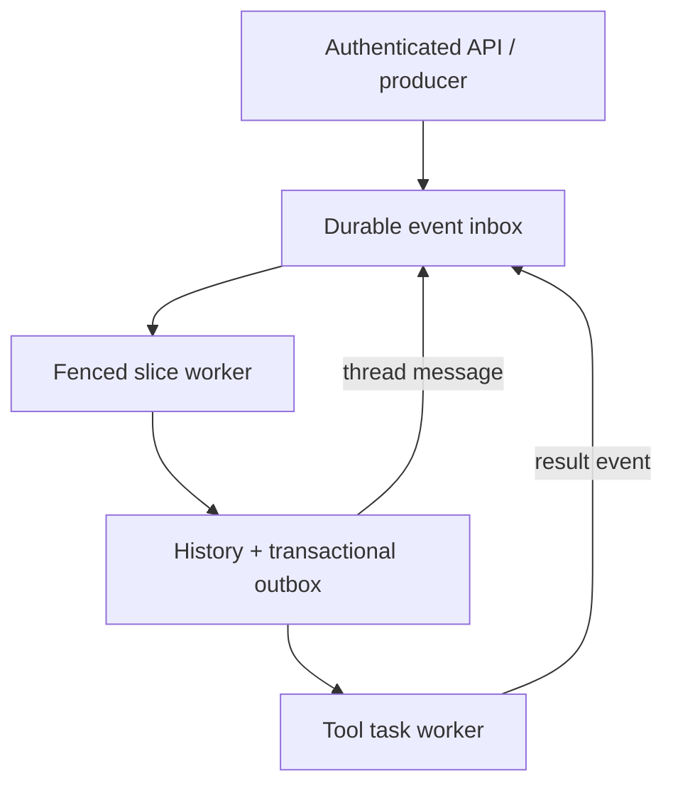

# SliceQueue

SliceQueue is a dependency-free Python/SQLite lab for **durable, event-driven agent execution**. It runs each thread as a sequence of bounded slices, persists a turn before dispatching side effects, suspends while tools run, and resumes from a durable result event. The core demo needs no cloud account, model API, paid service, or external credential.

This is an independent engineering implementation inspired by a documented AWS/UC Berkeley challenge. It is not AWS Infinity, is not affiliated with AWS or UC Berkeley, and makes no production-scale claim.

## The documented problem

Primary sources:

- Shadaj Laddad, [“Introducing Infinity: a runtime for extreme agent concurrency”](https://aws.amazon.com/blogs/opensource/introducing-infinity-a-runtime-for-extreme-agent-concurrency/), AWS Open Source Blog, 23 October 2026.
- [Infinity Runtime overview](https://infinity.hydro.run/docs/infinity-runtime/overview/), official project documentation.
- [hydro-project/infinity](https://github.com/hydro-project/infinity), official Apache-2.0 source repository.

### Documented facts

The AWS post says conventional agent harnesses often block while a tool runs, retaining a process and memory and preventing the agent from reacting to other events. Infinity instead saves the conversation and ends the execution slice. A later tool result, timer, user message, or child report resumes the thread from its input queue.

The same post identifies four serverless correctness requirements:

1. bounded execution that never waits on an unbounded operation;
2. no process affinity because state is stored by thread ID;
3. stable input IDs and deduplication for at-least-once delivery; and
4. durable turns committed before tool dispatch.

It also documents in-order, single-slice processing within a thread and parallel execution across independent threads. Its AWS reference deployment maps those ideas to SQS FIFO, Lambda, Aurora DSQL, DynamoDB, SQS delays, and EventBridge Scheduler.

### This project’s inference and scope

A useful fresher-level systems project should make those failure-sensitive invariants visible without copying a cloud architecture or requiring cloud spend. SliceQueue therefore maps the ideas onto SQLite transactions, leases, fencing tokens, an outbox, and a deterministic local policy. HMAC-linked history and audit records are additional project choices; they are not presented as Infinity features.

The business inference is that a runtime that releases compute while work waits can support long-running build, approval, triage, and subagent workflows more efficiently. Correctness is essential because duplicate queue deliveries, a worker crash after commit, or an early tool result can otherwise duplicate side effects or corrupt conversation order.

## What is implemented

- durable `USER`, `TOOL_RESULT`, `CHILD_REPORT`, and `TIMER` events;
- FIFO processing per ready thread with concurrent leases across threads;
- bounded slices that append one input and one assistant output;
- stable event IDs and conflict detection for non-identical retries;
- fenced, expiring worker leases and a five-attempt dead-letter state;
- transactional turn + tool/send outbox commit;
- idempotent outbox dispatch and tool completion;
- asynchronous, allow-listed tools whose results re-enter the event queue;
- delayed result/timer availability without a sleeping process;
- child-thread messaging through the same durable inbox;
- HMAC-SHA256 history and audit hash chains plus SQLite `quick_check`;
- bearer-token authentication, token-derived tenant namespaces, closed JSON schemas, size limits, and security headers;
- deterministic crash injection after slice, outbox, and tool transactions;
- an HTTP API, CLI, Docker image, GitHub Actions workflow, 32 automated tests, and a synthetic benchmark.

## Architecture



The critical ordering is:

1. claim one ready event under a lease token;
2. load that thread’s stored history;
3. produce one deterministic decision;
4. atomically append the event and assistant turn, increment the thread version, mark the event processed, and insert at most one outbox intent;
5. dispatch the outbox only after that transaction commits; and
6. deliver a tool result as a new event, which starts a later slice.

SQLite `BEGIN IMMEDIATE` supplies local transaction isolation. A thread version and lease token fence stale workers. The scheduler refuses a second lease for a thread but can lease ready events from other threads.

## Failure model and guarantees

| Failure | Mechanism | Observable guarantee |
| --- | --- | --- |
| Producer retries an input | Stable `(namespace, event_id)` plus request digest | Identical retry replays the record; changed payload conflicts |
| Slice commits but reply is lost | Event state, history, version, and outbox share one transaction | Retry cannot append the turn again |
| Outbox dispatch reply is lost | Unique outbox dedupe key and tool-task primary key | Redispatch creates no second task |
| Tool completion reply is lost | Stable `call_id`, result digest, and stable result-event ID | Identical retry succeeds as a replay; changed result conflicts |
| Worker pauses past its lease | Random lease token checked at commit | Reclaimed work fences the stale worker |
| Timer/tool result is not due | Indexed `available_ns` | No process waits; the event becomes claimable later |
| Poison item repeatedly expires | Attempt counter | Item becomes `DEAD` after five leases, unblocking later work |
| Stored history is modified | HMAC-linked history/audit chains | `verify` reports corruption when the signer secret is uncompromised |

The delivery model is **at least once at ingress with exactly-once durable state transition per stable event ID**. SliceQueue does not claim exactly-once execution of arbitrary external effects.

## Quick start

Python 3.11 or later is sufficient; runtime dependencies are zero.

```bash
cd projects/2026-11-01-slicequeue
python -m slicequeue demo
python -m unittest discover -v
python -m slicequeue benchmark --threads 250 --events-per-thread 2
```

The demo launches parent/child threads, retries duplicate input, injects a lost acknowledgement after each of three durable boundaries, completes an asynchronous sum, proves a delayed result is not claimed early, sends a cross-thread report, fires a timer, closes the child, and verifies every hash chain and relational invariant.

To retain a demo database for inspection:

```bash
python -m slicequeue demo --db /tmp/slicequeue-demo.db
SLICEQUEUE_SIGNING_SECRET='slicequeue-public-demo-signing-secret-v1' \
  python -m slicequeue verify --db /tmp/slicequeue-demo.db --namespace demo
```

The demo refuses to overwrite an existing database.

## HTTP service

The server requires a signing secret of at least 32 UTF-8 bytes and one or more comma-separated API tokens of at least 16 characters. Generate real values with a password manager or CSPRNG; do not reuse the placeholders below.

```bash
export SLICEQUEUE_SIGNING_SECRET='replace-with-at-least-32-random-bytes'
export SLICEQUEUE_API_TOKENS='replace-with-at-least-16-random-chars'
python -m slicequeue serve --db /tmp/slicequeue.db --host 127.0.0.1 --port 8080
```

Example request:

```bash
curl -sS -X POST http://127.0.0.1:8080/v1/threads \
  -H "Authorization: Bearer $SLICEQUEUE_API_TOKENS" \
  -H 'Content-Type: application/json' \
  -d '{"idempotency_key":"launch-1","thread_id":"root"}'
```

| Method | Route | Purpose |
| --- | --- | --- |
| `GET` | `/health` | unauthenticated liveness check |
| `POST` | `/v1/threads` | idempotently launch a root or child thread |
| `POST` | `/v1/threads/{id}/events` | enqueue a stable event, optionally delayed |
| `GET` | `/v1/threads/{id}` | read status and durable history |
| `POST` | `/v1/work/slices/{worker}` | process at most one ready slice |
| `POST` | `/v1/work/outbox` | dispatch committed tool/message intents |
| `POST` | `/v1/work/tools/{worker}` | execute at most one allow-listed local tool |
| `GET` | `/v1/stats` | inspect counts and queue states |
| `GET` | `/v1/integrity` | run relational and hash-chain verification |

API tokens are never stored. The server derives an opaque tenant namespace with HMAC, compares configured tokens in constant time, rejects duplicate/unknown JSON fields and non-finite values, caps bodies at 256 KiB, and never returns a traceback.

## Docker

```bash
docker build -t slicequeue .
docker run --rm slicequeue demo
```

Run the service with a persistent database:

```bash
docker run --rm -p 127.0.0.1:8080:8080 \
  -v slicequeue-data:/data \
  -e SLICEQUEUE_SIGNING_SECRET \
  -e SLICEQUEUE_API_TOKENS \
  slicequeue serve --db /data/slicequeue.db --host 0.0.0.0 --port 8080
```

The image runs as UID 10001 rather than root.

## Measured validation

Measured locally on 1 November 2026 in the supplied environment (Linux x86-64, Python 3.12.14):

- `python -m unittest discover -q`: **32 tests passed** in **3.179 s**;
- deterministic demo: **6/6 events processed**, **3/3 injected lost acknowledgements recovered**, **0 duplicate tool tasks**, **12 history records and 15 audit records verified**;
- synthetic benchmark: **500/500 events processed across 250 threads** in **2.173897 s** (**230.0 events/s**), followed by a successful integrity scan in **0.07009 s**; resulting SQLite database size was **995,328 bytes**.

The benchmark is a single-process, single-worker SQLite workload with tiny deterministic `ping` turns. It is evidence that this implementation works on this machine—not an AWS Infinity comparison, distributed-system result, capacity promise, or production SLO. Raw reproducible outputs are in [`reports/`](reports/).

## Test coverage

The standard-library test suite covers:

- canonical/closed JSON schemas and non-finite input rejection;
- idempotency conflicts and tenant isolation;
- FIFO scheduling, parallel thread leases, heartbeat, expiry, fencing, and dead-lettering;
- concurrent workers claiming distinct threads;
- all three post-commit lost-acknowledgement failpoints;
- transactional outbox, asynchronous tool results, cross-thread send, timer, and close;
- tool allow-listing and input bounds;
- HMAC history/audit tamper detection;
- authenticated HTTP behavior and safe error responses; and
- full demo and benchmark smoke paths.

## Security boundaries

- Only `math.sum` and `text.word_count` are executable; there is no shell, filesystem, network, or dynamic import tool.
- Public identifiers have a strict 128-character grammar. JSON and messages are bounded.
- The HMAC secret must remain stable for verification and confidential from database writers.
- Bearer authentication is intentionally small and local. Put TLS and production identity/rate limiting in front of this service.
- `verify` detects accidental or unauthorized mutation when the attacker lacks the HMAC secret; it is not an append-only external transparency log.

## Design tradeoffs

- **SQLite instead of cloud services:** makes transactions and failure injection reproducible, but `BEGIN IMMEDIATE` serializes database writes and limits horizontal throughput.
- **Polling API instead of resident orchestration:** exposes each state transition clearly, but a production driver would add backoff, metrics, autoscaling, and queue notifications.
- **One command per slice:** keeps commit semantics small and auditable, at the cost of additional turns for multi-action plans.
- **Availability time instead of sleeping workers:** proves durable suspension, but this lab has no background timer service; a caller invokes the worker when work is due.
- **Deterministic policy instead of an LLM:** removes credentials, nondeterminism, cost, and prompt risk from the correctness demo. A production adapter must validate model output with the same `SliceDecision` schema.
- **HMAC chains:** reveal mutation with a protected secret, but key rotation and external anchoring are out of scope.

## Known limits

This lab does not implement model-provider streaming, context compaction, cancellation, priorities, recurring subscriptions, multi-region replication, schema migration, distributed queue wake-ups, key rotation, metrics export, or production-grade authorization. The HTTP worker endpoints are operational controls, not a public multi-tenant control plane. SQLite files should not be shared over an unsafe network filesystem.

## Interview walkthrough

1. **Problem (45 seconds):** explain why retaining one process per long-running tool call wastes resources and why at-least-once delivery threatens correctness.
2. **Invariant (60 seconds):** show that a thread owns a monotonically increasing version and can have only one live event lease; different threads remain independent.
3. **Transaction (90 seconds):** walk through `commit_slice`: validate fence/version, append two HMAC-linked records, write an outbox intent, advance the thread, and mark the event processed in one commit.
4. **Failure (60 seconds):** run `python -m slicequeue demo`; point out that all three injected crashes happen after durable commits, yet replay creates no duplicate turn, task, or result.
5. **Security and tradeoff (45 seconds):** discuss strict schemas/tool allow-listing and why SQLite is excellent for a local proof but not a replacement for the documented SQS/Lambda/DSQL/DynamoDB design.
6. **Scale-out path (30 seconds):** partition by thread ID, preserve per-thread FIFO, keep stable IDs/fencing/outbox semantics, and move storage/queues behind equivalent interfaces.

## Evidence-based resume bullets

- Built a dependency-free Python/SQLite event-driven agent runtime with per-thread FIFO scheduling, fenced leases, transactional outbox dispatch, delayed resumptions, inter-thread messaging, and HMAC-linked audit/history verification.
- Authored 32 unit/integration tests and deterministic post-commit failure injection; locally recovered three lost acknowledgements without duplicate state and processed 500/500 synthetic events at 230.0 events/s before a successful integrity scan.
