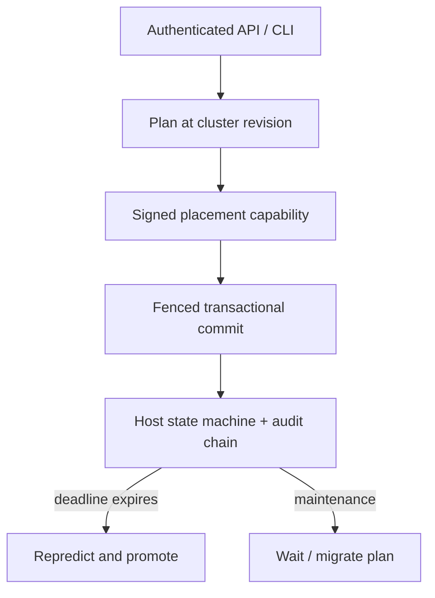

# ExitPack

ExitPack is a dependency-free Python/SQLite control-plane lab for **lifetime-aware virtual-machine placement**. It groups workloads by expected lifetime, fills recycling hosts only with substantially shorter jobs, adapts when a prediction expires, fences stale placement and migration decisions, and produces a maintenance plan that lets soon-to-exit VMs finish instead of migrating everything.

The complete demo is local: it needs no cloud account, paid service, ML model, or external credential. This is an independent implementation inspired by Google's LAVA research. It is not Google LAVA, is not affiliated with Google, and makes no production-scale claim.

## The documented company problem

Primary sources:

- Pratik Worah and Martin Maas, [“Solving virtual machine puzzles: How AI is optimizing cloud computing”](https://research.google/blog/solving-virtual-machine-puzzles-how-ai-is-optimizing-cloud-computing/), Google Research, 17 October 2025.
- Jianheng Ling et al., [“LAVA: Lifetime-Aware VM Allocation with Learned Distributions and Adaptation to Mispredictions”](https://arxiv.org/abs/2412.09840), version 2, 4 June 2025.
- Abhishek Verma et al., [“Large-scale cluster management at Google with Borg”](https://research.google/pubs/large-scale-cluster-management-at-google-with-borg/), EuroSys 2015.

### Documented facts

Google describes VM scheduling as a bin-packing problem with incomplete lifetime information. Poor placement can strand CPU or memory in unusable shapes and reduce the number of completely empty hosts. Empty hosts matter for large VM admission, system updates, defragmentation, and idle-power optimization.

The LAVA work says one prediction made at VM creation is brittle: a single VM that runs far longer than predicted can hold a host open. Its response is continuous reprediction plus three algorithms:

- NILAS scores hosts by the repredicted exit times of their resident VMs;
- LAVA maintains lifetime-aware host states, uses shorter VMs to fill gaps around longer residual VMs, and promotes a host's expected lifetime after an underprediction; and
- LARS orders maintenance work by predicted remaining lifetime so short jobs can exit naturally and longer jobs are migrated first.

Google reports its own production and simulation results in the sources above. Those numbers describe Google's system, workloads, model, and rollout—not ExitPack.

### This project's inference and scope

A strong standalone systems project can demonstrate the control-plane correctness surrounding a lifetime model even when the model and fleet telemetry are unavailable. ExitPack therefore accepts a bounded predicted lifetime as input and implements a transparent, deterministic adaptation rule. It maps the paper's four lifetime orders of magnitude to `<=1h`, `<=10h`, `<=100h`, and `<=1000h` classes.

The business inference is that preserving empty machines and reducing unnecessary migration work can improve large-VM admission headroom, maintenance flexibility, and infrastructure efficiency. The engineering risk is not only placement quality: retries, concurrent schedulers, stale plans, operator drains, corrupt state, and prediction errors can all turn a useful heuristic into an unsafe control plane. ExitPack makes those failure cases testable.

## What is implemented

- `BEST_FIT` baseline and lifetime-aware placement policies;
- `EMPTY`, `OPEN`, `RECYCLING`, and operator-owned `DRAINING` host states;
- four bounded lifetime classes and deterministic host deadline reprediction;
- short-job filling on recycling hosts and class promotion after underprediction;
- separate plan/commit phases with HMAC-signed plan capabilities;
- optimistic cluster-revision fencing for concurrent placements and migrations;
- stable idempotency keys with conflict detection for non-identical retries;
- atomic VM finish and migration operations with post-commit crash injection;
- maintenance decisions that wait for near-exit VMs and prioritize longer migrations;
- CPU/memory capacity checks, drain exclusion, and namespace isolation;
- HMAC-SHA256 audit chains, relational invariant checks, and SQLite `quick_check`;
- bearer-authenticated HTTP API with token-derived tenant IDs, closed JSON schemas, a 256 KiB body limit, constant-time token comparison, and security headers;
- CLI demo, policy benchmark, Docker image, GitHub Actions workflow, and 36 automated tests.

## Architecture



The write path deliberately separates decision from effect:

1. validate the closed VM schema and reconcile expired host deadlines;
2. choose an eligible host against one cluster revision;
3. persist a `PLANNED` record and return an HMAC-bound commit token;
4. at commit, verify the token, revision, drain state, capacity, and lifetime eligibility again;
5. atomically create the VM, update the host state, mark the plan committed, advance the revision, and append an audit entry; and
6. replay a committed plan without creating a second VM if the acknowledgement was lost.

SQLite `BEGIN IMMEDIATE`, foreign keys, WAL mode, and `synchronous=FULL` provide a reproducible local transaction boundary. The cluster revision is a fencing token, not a distributed consensus protocol.

## Lifetime host state machine

| State | Meaning | Placement rule |
| --- | --- | --- |
| `EMPTY` | No running VMs | Any lifetime class may open it |
| `OPEN` | Building one lifetime cohort | Only the same class is admitted |
| `RECYCLING` | Host reached 90% CPU or memory, or missed its deadline | Only a strictly shorter class may fill freed gaps |
| `DRAINING` | Operator reserved the host for evacuation | No new placement or migration destination |

When an `OPEN` host reaches the 90% threshold, its current VMs become the residual cohort and the host begins recycling. Once that cohort exits, any remaining short fillers become the next residual cohort and the host is reclassified. If a VM remains after the host deadline, reconciliation promotes the host by one lifetime class, extends its deadline, and keeps it in `RECYCLING`. This deterministic rule demonstrates feedback; it is not Google's learned survival model.

## Correctness and failure model

| Failure | Mechanism | Observable guarantee |
| --- | --- | --- |
| Two schedulers plan concurrently | Namespace cluster revision | First commit advances the revision; the other plan is stale |
| Plan is modified or guessed | HMAC capability over immutable plan material | Commit rejects an invalid token |
| Placement reply is lost | Durable committed-plan status | Retrying the same plan returns `replayed: true` without a second VM |
| Finish/migration reply is lost | Operation-scoped idempotency key and request digest | Identical retry replays; changed input conflicts |
| Host is drained after planning | Drain state rechecked at commit | Planned placement cannot enter a draining host |
| Lifetime estimate is too short | Deadline reconciliation | Host class is promoted and new short fillers remain constrained |
| State is modified out of band | HMAC-linked audit log plus invariant scan | Verification reports tampering, overcapacity, or invalid relations |

ExitPack claims atomic durable transitions within one SQLite database. It does not claim exactly-once execution of an external hypervisor action; a production system would need an outbox or reconciler between desired and observed VM state.

## Quick start

Python 3.11 or later is sufficient; runtime dependencies are zero.

```bash
cd projects/2026-11-02-exitpack
python -m exitpack demo
python -m unittest discover -v
python -m exitpack benchmark --hosts 40 --groups 32
```

The demo builds two isolated namespaces and exercises mixed-lifetime maintenance, concurrent stale plans, a lost placement reply, a lost finish reply, deadline misprediction, and full integrity verification.

To retain a demo database for inspection:

```bash
python -m exitpack demo --db /tmp/exitpack-demo.db
EXITPACK_SIGNING_SECRET='exitpack-public-demo-signing-secret-v1' \
  python -m exitpack verify --db /tmp/exitpack-demo.db
```

The demo refuses to overwrite an existing database.

## HTTP service

The server requires a signing secret of at least 32 bytes and one or more comma-separated API tokens of 16–512 printable ASCII characters. Generate real values with a password manager or CSPRNG; the strings below are placeholders.

```bash
export EXITPACK_SIGNING_SECRET='replace-with-at-least-32-random-bytes'
export EXITPACK_API_TOKENS='replace-with-at-least-16-random-chars'
python -m exitpack serve --db /tmp/exitpack.db --host 127.0.0.1 --port 8080
```

Register a host:

```bash
curl -sS -X POST http://127.0.0.1:8080/v1/hosts \
  -H "Authorization: Bearer $EXITPACK_API_TOKENS" \
  -H 'Content-Type: application/json' \
  -d '{"idempotency_key":"host-1","host_id":"host-a","zone":"zone-a","cpu_capacity":16000,"memory_capacity":64000}'
```

| Method | Route | Purpose |
| --- | --- | --- |
| `GET` | `/health` | unauthenticated liveness |
| `POST` | `/v1/hosts` | idempotently register capacity |
| `POST` | `/v1/plans` | choose a host and create a signed, revision-bound plan |
| `POST` | `/v1/plans/{id}/commit` | atomically commit the plan |
| `POST` | `/v1/vms/{id}/finish` | idempotently mark a VM finished |
| `POST` | `/v1/vms/{id}/migrate` | revision-fenced migration |
| `POST` | `/v1/hosts/{id}/drain` | exclude a host from new work |
| `POST` | `/v1/hosts/{id}/maintenance-plan` | compare eager and lifetime-aware migration work |
| `POST` | `/v1/reconcile` | adapt expired host predictions |
| `GET` | `/v1/snapshot`, `/v1/metrics`, `/v1/integrity` | inspect tenant state |

API tokens are never persisted. The HMAC secret must remain stable for verification. Put TLS, production identity, rate limiting, and request logging controls in front of this educational server.

## Docker

```bash
docker build -t exitpack .
docker run --rm exitpack demo
```

Run the API with a persistent database:

```bash
docker run --rm -p 127.0.0.1:8080:8080 \
  -v exitpack-data:/data \
  -e EXITPACK_SIGNING_SECRET \
  -e EXITPACK_API_TOKENS \
  exitpack serve --db /data/exitpack.db --host 0.0.0.0 --port 8080
```

The image runs as UID 10001 instead of root.

## Measured validation

Measured locally on 2 November 2026 in the supplied Linux x86-64 environment with Python 3.12.14:

- `python -m unittest discover -q`: **36 tests passed** in **3.896 s**;
- deterministic demo: **2/2 injected lost acknowledgements recovered**, the stale concurrent plan was rejected, the underpredicted host adapted from class 0 to class 1, and **25 audit entries / 8 plans / 7 VMs** passed verification;
- maintenance scenario: waiting for three VMs predicted to exit within 30 minutes reduced the plan from **4 eager migrations to 1 migration**;
- synthetic two-policy benchmark: **512 total placements and 448 short-VM completions** at **207.59 placements/s**; after those completions, best-fit had **8/40 empty hosts** and lifetime-aware placement had **36/40**; both policy databases passed integrity verification.

The benchmark intentionally feeds each policy 32 groups of one long VM followed by seven short VMs. That adversarial ordering favors lifetime separation and is useful as a reproducible mechanism test. The **28-host / 70-percentage-point difference is not a general capacity estimate**, not Google data, not an ML-model evaluation, and not a comparison with Google's LAVA implementation. Raw recorded summaries are in [`reports/`](reports/).

## Test coverage

The standard-library test suite covers:

- lifetime boundaries, numeric bounds, canonical JSON, duplicate fields, and closed schemas;
- idempotent registration and conflicting key reuse;
- best-fit mixing, same-class packing, recycling fillers, and capacity exhaustion;
- two plans from one revision, invalid capabilities, and lost placement acknowledgements;
- prediction promotion and recycling-cohort reclassification;
- drain exclusion, migration fencing/replay, and maintenance ordering;
- lost finish acknowledgements and finished-VM conflict behavior;
- audit tampering, overcapacity corruption, SQLite and relational verification;
- API authentication, namespace isolation, canonical paths, security headers, and the full placement lifecycle; and
- deterministic demo and benchmark smoke paths.

## Security boundaries

- Public identifiers use a strict 128-character grammar; resources and lifetimes have explicit upper bounds.
- JSON bodies reject duplicate/unknown fields and non-finite values and are capped at 256 KiB.
- Plan capabilities and audit entries use HMAC-SHA256 with constant-time comparison.
- A bearer token derives an opaque namespace; no raw token is stored in SQLite.
- Integrity verification assumes database writers do not possess the HMAC key. It is not an external append-only transparency service.
- This lab stores predicted lifetimes and topology metadata; production telemetry privacy, key rotation, RBAC, mTLS, and secret management are out of scope.

## Design tradeoffs

- **Deterministic classes instead of ML:** makes every transition explainable and reproducible, but cannot model conditional lifetime distributions or confidence.
- **SQLite instead of a distributed store:** makes atomicity and crash injection easy to inspect, but serializes writers and is not multi-region.
- **Global namespace revision:** strongly fences stale decisions, but unrelated host activity can force replanning. Per-host versions could reduce false conflicts.
- **90% recycling threshold:** exposes a clear state transition, but a production value should be workload- and resource-shape-aware.
- **HMAC-bound plan token:** prevents accidental/unauthorized plan mutation, but it is not a hypervisor authorization protocol.
- **Explicit reconcile call:** keeps time deterministic in tests; production would schedule reconciliation and cache prediction updates.

## Known limits

ExitPack has no learned model, trace-trained distributions, topology-aware failure domains, reservations, preemption, NUMA/device constraints, oversubscription, autoscaling, background controller, live hypervisor integration, or distributed consensus. It uses CPU and memory only. Maintenance output is a plan; migration execution is an explicit API call. Finished VM history is retained, and there is no schema/key rotation tooling.

## Interview walkthrough

1. **Problem (45 seconds):** explain resource stranding, why empty hosts have operational value, and why one-shot lifetime prediction is dangerous.
2. **Placement state machine (75 seconds):** walk through `EMPTY → OPEN → RECYCLING`, then show why recycling accepts only shorter lifetime classes.
3. **Correctness path (90 seconds):** create two plans from one revision, commit one, and explain why the second is fenced; then retry a post-commit crash and show there is still one VM.
4. **Feedback (60 seconds):** run the demo and point to class promotion after the predicted deadline; distinguish this rule from Google's learned continuous reprediction.
5. **Evidence (60 seconds):** explain the synthetic benchmark shape and why it proves the mechanism but cannot predict fleet savings.
6. **Scale-out design (45 seconds):** replace SQLite with a linearizable metadata service, partition revisions more finely, add desired/observed reconciliation and an outbox, and retain idempotency, fencing, drain state, and audit invariants.

## Evidence-based resume bullets

- Built a dependency-free Python/SQLite VM placement control plane with lifetime-class host states, adaptive deadline reconciliation, signed two-phase plans, optimistic revision fencing, idempotent recovery, maintenance/migration planning, and HMAC-linked integrity verification.
- Authored 36 unit/integration tests and deterministic failure injection; locally recovered 2/2 lost acknowledgements and, in an explicitly adversarial 512-placement synthetic benchmark, preserved 36/40 empty hosts versus 8/40 for the included best-fit baseline with both integrity scans valid.
